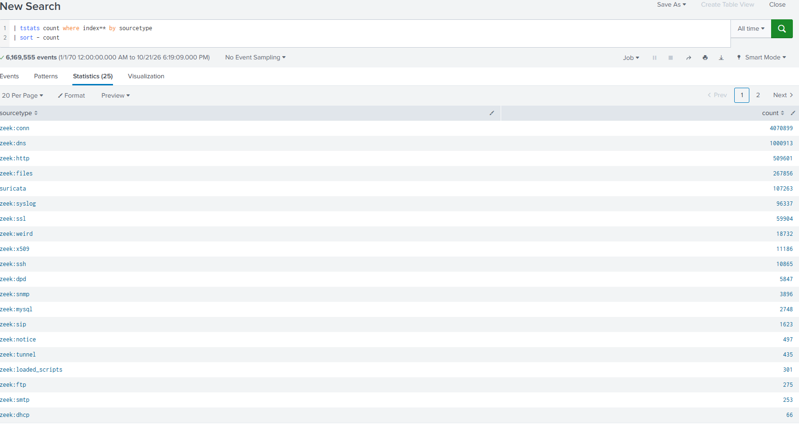
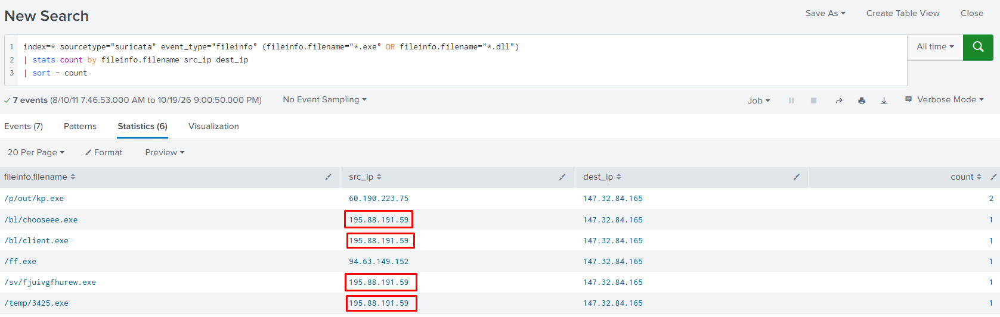
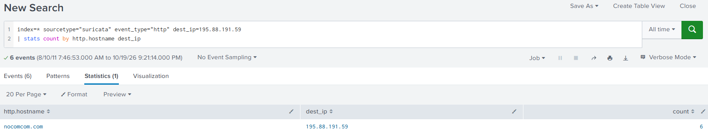
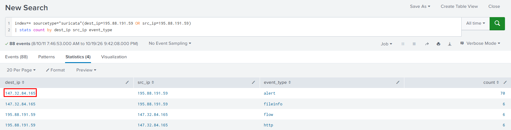
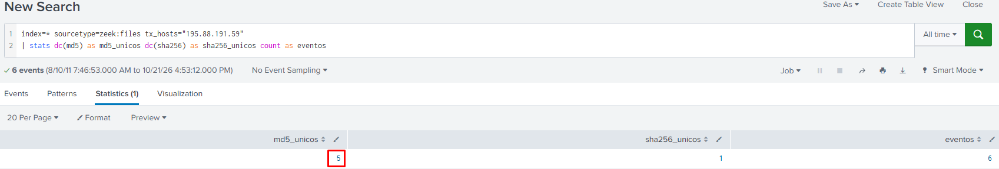
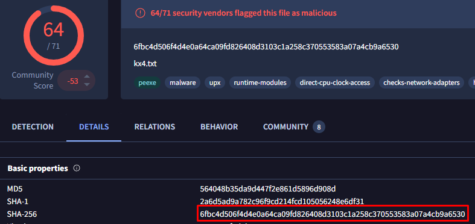

# NerisBot Lab

## 1. Contexto

**Escenario:** Se ha detectado actividad de red inusual dentro de un entorno universitario, lo que indica una posible intención maliciosa. Estas anomalías, observadas hace seis horas, sugieren la presencia de comunicaciones de comando y control (C2) y otros comportamientos dañinos dentro de la red.

A su equipo se le ha encomendado la tarea de analizar registros de tráfico de red recientes para investigar el alcance y el impacto de estas actividades. La investigación tiene como objetivo identificar servidores de comando y control y descubrir interacciones maliciosas.

## 2. Preguntas del lab

### Resumen de preguntas y respuestas

| N.º | Pregunta | Respuesta | Técnica ATT&CK |
| --- | --- | --- | --- |
| P1 | ¿Desde qué IP se originó el acceso no autorizado inicial? | 195.88.191.59 | T1105 |
| P2 | ¿Cuál es el nombre de dominio del servidor atacante? | nocomcom.com | Ninguna |
| P3 | ¿Cuál es la IP del sistema comprometido? | 147.32.84.165 | Ninguna |
| P4 | ¿Cuántos archivos únicos descargados al host comprometido podrían ser maliciosos? | 5 | T1105 |
| P5 | ¿Cuál es el SHA256 del archivo malicioso disfrazado de `.txt`? | 6fbc4d506f4d4e0a64ca09fd826408d3103c1a258c370553583a07a4cb9a6530 | T1036.008, T1105 |

### Análisis pregunta a pregunta

#### P1

> **Pregunta:** Durante la investigación del tráfico de la red, se observaron patrones inusuales de actividad en los registros de Suricata, lo que sugiere un posible acceso no autorizado. Una dirección IP externa inició intentos de acceso y luego se la vio descargando un archivo ejecutable sospechoso. Esta actividad indica fuertemente el origen del ataque. ¿Cuál es la dirección IP desde la que se originó el acceso no autorizado inicial?

> **Respuesta:** 195.88.191.59

**Análisis: cómo he llegado**

- **Qué busco:** una IP externa que descargue un ejecutable hacia la red de la universidad, usando los eventos `fileinfo` de Suricata en Splunk.

**Pasos previos**

Paso 1: reconocer los datos. Necesito saber qué sourcetypes hay y si existe el de Suricata.

```spl
| tstats count where index=* by sourcetype
| sort - count
```



Resultado del paso 1: existe el sourcetype `suricata` (107.263 eventos). Sus campos útiles son `src_ip`, `dest_ip`, `event_type` y `alert.signature`. Dentro de `event_type` me interesan `alert`, `http` y `fileinfo`.

Paso 2: probar con las alertas. Conté las firmas distintas de `event_type="alert"`.

```spl
index=* sourcetype="suricata" event_type="alert"
| stats count by alert.signature
| sort count
```

Resultado del paso 2: hay 10 firmas (2.872 alertas) y todas son avisos del propio motor (`SURICATA TCPv4 invalid checksum`, etc.). Ninguna describe un ataque, así que el rastro no está en `alert`. Cambio a `fileinfo`.

- **Consulta o comando:**

```spl
index=* sourcetype="suricata" event_type="fileinfo" (fileinfo.filename="*.exe" OR fileinfo.filename="*.dll")
| stats count by fileinfo.filename src_ip dest_ip
| sort - count
```

- **Resultado:**



Tres IPs externas envían ejecutables al mismo `dest_ip` (147.32.84.165): 195.88.191.59 (4 ficheros distintos), 60.190.223.75 (`kp.exe`, 2 veces) y 94.63.149.152 (`ff.exe`, 1 vez).

- **Por qué esa es la respuesta:** es una IP externa y la que más ejecutables distintos envía al mismo equipo. La plataforma la da por buena.
- **Técnica ATT&CK:** T1105, Ingress Tool Transfer.

#### P2

> **Pregunta:** Investigar el dominio del atacante ayuda a identificar la infraestructura utilizada para el ataque, evaluar sus conexiones con otras amenazas y tomar medidas para mitigar futuros ataques. ¿Cuál es el nombre de dominio del servidor atacante?

> **Respuesta:** nocomcom.com

**Análisis: cómo he llegado**

- **Qué busco:** el nombre de dominio asociado a la IP del atacante (195.88.191.59). En los eventos `http` de Suricata, la cabecera Host indica a qué nombre se pidió el contenido.

- **Consulta o comando:**

```spl
index=* sourcetype="suricata" event_type="http" dest_ip=195.88.191.59
| stats count by http.hostname dest_ip
```

- **Resultado:**



Una sola fila: `nocomcom.com`, con 6 eventos HTTP hacia `195.88.191.59`.

- **Por qué esa es la respuesta:** todas las peticiones HTTP hacia la IP del atacante llevan el mismo hostname, `nocomcom.com`, así que no hay ambigüedad. En `http` el flujo se registra desde quien pide, por eso el atacante va en `dest_ip` (en `fileinfo` iba en `src_ip`). No comprobé la resolución en `dns`.
- **Técnica ATT&CK:** ninguna.

#### P3

> **Pregunta:** Conocer la dirección IP del sistema objetivo ayuda a centrar los esfuerzos de remediación y evaluar el alcance del compromiso. ¿Cuál es la dirección IP del sistema que fue objeto de esta violación?

> **Respuesta:** 147.32.84.165

**Análisis: cómo he llegado**

- **Qué busco:** la IP del equipo que recibió el ataque. Parto de la IP del atacante (195.88.191.59) y miro con qué otras IPs intercambia tráfico en Suricata.

- **Consulta o comando:**

```spl
index=* sourcetype="suricata" (dest_ip=195.88.191.59 OR src_ip=195.88.191.59)
| stats count by dest_ip src_ip event_type
```

- **Resultado:**



88 eventos en 4 filas. Siempre aparece la misma IP al otro lado del atacante:

| dest_ip | src_ip | event_type | count |
| --- | --- | --- | --- |
| 147.32.84.165 | 195.88.191.59 | alert | 70 |
| 147.32.84.165 | 195.88.191.59 | fileinfo | 6 |
| 195.88.191.59 | 147.32.84.165 | flow | 6 |
| 195.88.191.59 | 147.32.84.165 | http | 6 |

- **Por qué esa es la respuesta:** es la única IP que habla con el atacante, y es quien recibe los ficheros (`fileinfo`) y quien hace las peticiones HTTP hacia `nocomcom.com`. El lado de `src_ip` y `dest_ip` cambia según el `event_type`: en `alert` y `fileinfo` el atacante es el origen, y en `http` y `flow` es el destino. Los 70 `alert` son del ruido de checksum que vimos en P1, así que lo que demuestra que es la víctima es el `fileinfo`. Solo vi tráfico directo con este atacante, así que no descarto otros equipos afectados.
- **Técnica ATT&CK:** ninguna.

#### P4

> **Pregunta:** Identifique todos los archivos únicos descargados al host comprometido. ¿Cuántos de estos archivos podrían ser potencialmente maliciosos?

> **Respuesta:** 5

**Análisis: cómo he llegado**

- **Qué busco:** cuántos ficheros distintos (por contenido, no por nombre) llegaron al equipo comprometido desde la IP del atacante (195.88.191.59).

**Pasos previos**

Paso 1: mirar los ficheros ejecutables que recibe la víctima en Suricata.

```spl
index=* sourcetype="suricata" event_type="fileinfo" dest_ip=147.32.84.165 (fileinfo.filename="*.exe" OR fileinfo.filename="*.dll")
| stats count by fileinfo.filename src_ip
| sort - count
```

Resultado del paso 1: 6 nombres de fichero distintos, todos `.exe`. Cuatro vienen de 195.88.191.59, uno de 60.190.223.75 y uno de 94.63.149.152. La plataforma da por buena la respuesta 5, así que contar nombres (6) no coincide.

Paso 2: buscar un campo de hash o de tipo real en `fileinfo`. En la lista de campos solo había nombre, tamaño, estado y gaps. Suricata no guarda hashes en estos datos, así que hay que usar Zeek, cuyo sourcetype `zeek:files` sí los tiene.

- **Consulta o comando:**

```spl
index=* sourcetype=zeek:files tx_hosts="195.88.191.59"
| stats dc(md5) as md5_unicos dc(sha256) as sha256_unicos count as eventos
```

- **Resultado:**



| md5_unicos | sha256_unicos | eventos |
| --- | --- | --- |
| 5 | 1 | 6 |

- **Por qué esa es la respuesta:** `tx_hosts` filtra los ficheros que Zeek vio enviar desde la IP del atacante, y `dc(md5)` cuenta contenidos distintos, no nombres. Salen 5 MD5 distintos en 6 eventos, que coincide con el 5 que da la plataforma. Es el número de ficheros únicos que podrían ser maliciosos, porque todos los envía el servidor del atacante. El contenido repetido es `kx4.txt`, que se descargó dos veces con el mismo MD5 (ver P5): por eso 6 eventos dan 5 MD5 distintos. `sha256_unicos` sale 1 porque Zeek no calculó SHA256 (`analyzers` = `SHA1,MD5,PE`) y el campo vale `-` en todos los eventos, y `dc()` cuenta ese `-` como un valor. Los hashes están verificados en VirusTotal.
- **Técnica ATT&CK:** T1105, Ingress Tool Transfer. Los ficheros se descargan desde un servidor externo al equipo comprometido.

#### P5

> **Pregunta:** ¿Cuál es el hash SHA256 del archivo malicioso disfrazado de `.txt` archivo?

> **Respuesta:** 6fbc4d506f4d4e0a64ca09fd826408d3103c1a258c370553583a07a4cb9a6530

**Análisis: cómo he llegado**

- **Qué busco:** un fichero que se llama `.txt` pero cuyo contenido es otra cosa, y su hash SHA256. El nombre lo da Suricata, y el tipo real y los hashes los da Zeek.

**Pasos previos**

Paso 1: buscar en Suricata los ficheros `.txt` que llegan a la víctima, con su tamaño y su origen.

```spl
index=* sourcetype="suricata" event_type="fileinfo" dest_ip=147.32.84.165 fileinfo.filename="*.txt*"
| table _time fileinfo.filename fileinfo.size src_ip
```

Resultado del paso 1: `/kx4.txt`, 37376 bytes, enviado por 195.88.191.59 en dos ocasiones (09:06 y 10:10).

Paso 2: en Zeek el campo `filename` vale `-`, así que no se puede buscar por nombre. Uso el tamaño como puente entre las dos fuentes. Además, `sha256` también vale `-` porque el analizador solo calculó SHA1 y MD5 (`analyzers` = `SHA1,MD5,PE`).

- **Consulta o comando:**

```spl
index=* sourcetype=zeek:files tx_hosts="195.88.191.59" seen_bytes=37376
| table _time seen_bytes mime_type md5 sha1
```

- **Resultado:**

| _time | seen_bytes | mime_type | md5 | sha1 |
| --- | --- | --- | --- | --- |
| 2011-08-10 09:06:50.804 | 37376 | application/x-dosexec | 564048b35da9d447f2e861d5896d908d | 2a6d5ad9a782c96f9cd214fcd105056248e6df31 |
| 2011-08-10 10:10:21.303 | 37376 | application/x-dosexec | 564048b35da9d447f2e861d5896d908d | 2a6d5ad9a782c96f9cd214fcd105056248e6df31 |

Captura de VT a partir del MD5, de donde saco el SHA256:



- **Por qué esa es la respuesta:** `kx4.txt` se llama `.txt`, pero Zeek detecta por contenido `application/x-dosexec`, es decir, un ejecutable de Windows. El tamaño (37376) coincide en Suricata y en Zeek, y las dos filas de Zeek comparten MD5 y SHA1, así que es el mismo contenido recibido dos veces, igual que las dos descargas de `kx4.txt`. El SHA256 no sale de Splunk: lo obtuve buscando el MD5 en VirusTotal. El tamaño por sí solo no demuestra que sea el mismo fichero, y la correspondencia entre Zeek y Suricata es una inferencia mía.
- **Técnica ATT&CK:** T1036.008 (Masquerading: Masquerade File Type), porque un ejecutable se hace pasar por un `.txt`. La entrega al equipo es T1105 (Ingress Tool Transfer).

## 3. Cierre

### Cadena del ataque

Todas las horas son del 2011-08-10 y salen de los eventos `fileinfo` de Suricata. El equipo de la universidad `147.32.84.165` descarga los ficheros por HTTP desde `nocomcom.com` (`195.88.191.59`) y desde otras dos IPs que no está confirmado que formen parte del mismo ataque.

1. **09:01:40 (aprox.)** Descarga `/temp/3425.exe` desde `195.88.191.59`. La hora es aproximada: siete eventos de IPs distintas comparten exactamente esa marca de tiempo.
2. **09:06:53** Descarga `/kx4.txt` desde `195.88.191.59`, que en realidad es un ejecutable de Windows (37.376 bytes, `application/x-dosexec`).
3. **09:06:57** Recibe `/ff.exe` desde `94.63.149.152`.
4. **09:07:51** Descarga `/bl/chooseee.exe` desde `195.88.191.59`.
5. **10:10:10** Recibe `/p/out/kp.exe` desde `60.190.223.75` (23.955 bytes).
6. **10:10:34** Vuelve a descargar `/kx4.txt` desde `195.88.191.59`, con el mismo MD5 y SHA1.
7. **11:02:11** Descarga `/bl/client.exe` desde `195.88.191.59`.
8. **11:02:12** Recibe otra vez `/p/out/kp.exe` desde `60.190.223.75`, ahora con otro tamaño (46.435 bytes), así que no es el mismo contenido.
9. **11:02:21** Descarga `/sv/fjuivgfhurew.exe` desde `195.88.191.59`.

### TTPs

| Táctica | Técnica | Evidencia que la demuestra |
| --- | --- | --- |
| Command and Control | T1105 Ingress Tool Transfer | Eventos `fileinfo` de Suricata y `zeek:files`: ejecutables enviados desde `195.88.191.59` a `147.32.84.165` |
| Defense Evasion | T1036.008 Masquerading: Masquerade File Type | `kx4.txt` se llama `.txt`, pero Zeek lo identifica por contenido como `application/x-dosexec` |

### IOCs

| Tipo | Valor | Contexto |
| --- | --- | --- |
| IP | 195.88.191.59 | Servidor del atacante que entrega los ejecutables |
| Dominio | nocomcom.com | Hostname de las peticiones HTTP hacia `195.88.191.59` |
| URL (ruta) | /bl/chooseee.exe, /bl/client.exe, /sv/fjuivgfhurew.exe, /temp/3425.exe, /kx4.txt | Ficheros descargados desde `nocomcom.com` |
| SHA256 | 6fbc4d506f4d4e0a64ca09fd826408d3103c1a258c370553583a07a4cb9a6530 | `kx4.txt`, ejecutable disfrazado (64/71 en VirusTotal) |
| SHA1 | 2a6d5ad9a782c96f9cd214fcd105056248e6df31 | `kx4.txt` |
| MD5 | 564048b35da9d447f2e861d5896d908d | `kx4.txt` |
| IP | 60.190.223.75, 94.63.149.152 | También envían ejecutables (`kp.exe`, `ff.exe`) a la víctima. Sospecha, sin confirmar |

### Una idea de detección

- **Qué detectaría:** un ejecutable de Windows descargado con una extensión que no es de ejecutable (`.txt`, `.jpg`, etc.).
- **Fuente de datos:** Zeek `files.log` y `http.log` (o `fileinfo` de Suricata si tiene activado el campo `magic`).
- **Lógica:** alertar cuando `mime_type` es `application/x-dosexec` y la URI o el nombre del fichero en la petición HTTP no termina en `.exe`, `.dll` ni `.msi`. Sube la prioridad si el servidor no es un repositorio de software conocido o si el mismo equipo descarga varios ejecutables del mismo dominio en poco tiempo.
- **Falso positivo probable:** actualizadores de software legítimo que sirven binarios con extensiones genéricas o sin extensión.
