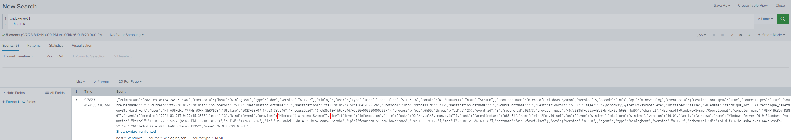
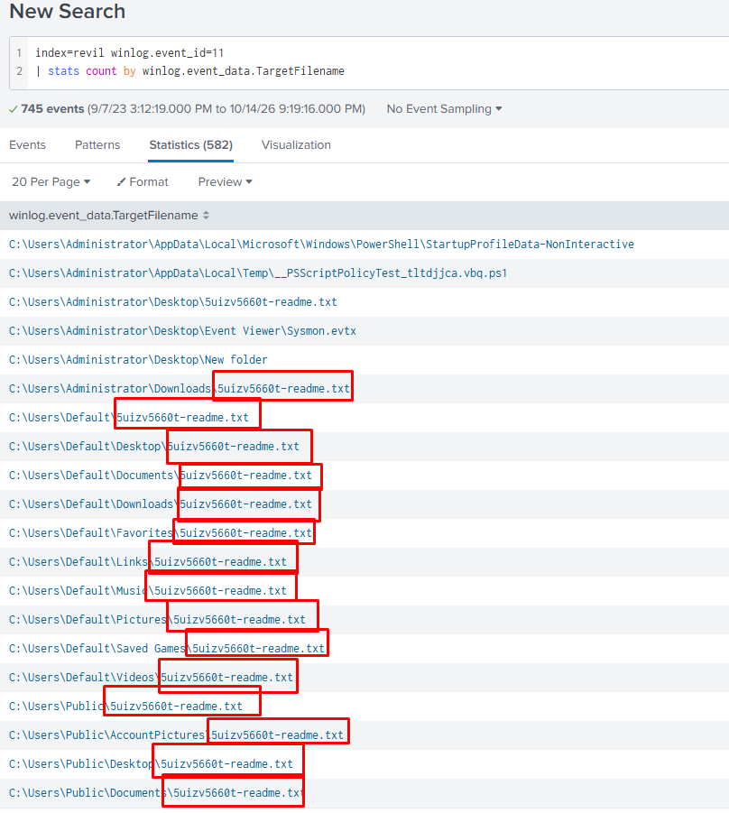
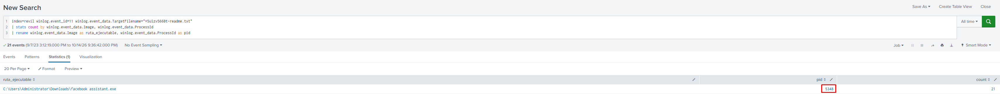
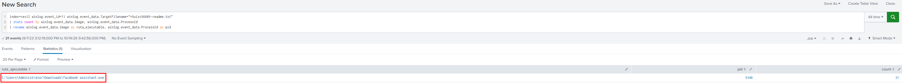
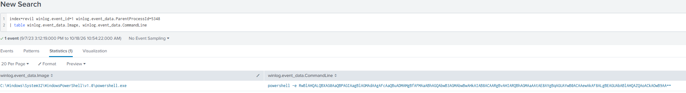
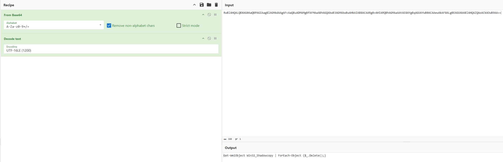
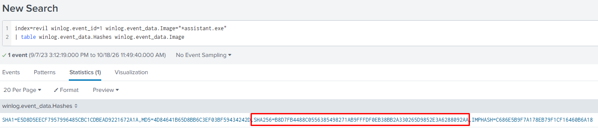
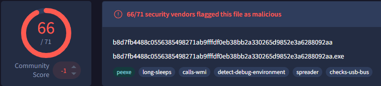
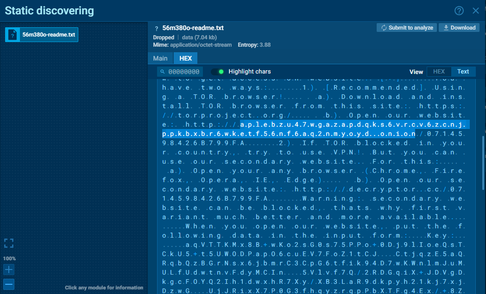

# REvil - GOLD SOUTHFIELD Lab

## 1. Contexto

**Escenario en una frase:** Eres un cazador de amenazas que trabaja para una empresa de consultoría en ciberseguridad. Uno de sus clientes se ha visto afectado recientemente por un ataque de ransomware que provocó el cifrado de varias de las máquinas de sus empleados. Los usuarios afectados informaron haber encontrado una nota de rescate en su escritorio y un fondo de escritorio modificado. Su tarea es utilizar Splunk SIEM que contiene registros de eventos Sysmon de una de las máquinas cifradas para extraer la mayor cantidad de información posible.

## 2. Preguntas del lab

### Resumen de preguntas y respuestas

| N.º | Pregunta                                                          | Respuesta                                                         | Técnica ATT&CK              |
| --- | ----------------------------------------------------------------- | ----------------------------------------------------------------- | --------------------------- |
| P1  | ¿Cuál es el nombre del archivo de la nota que dejó el ransomware? | 5uizv5660t-readme.txt                                             | T1486                       |
| P2  | ¿Cuál es el ID del proceso del ransomware?                        | 5348                                                              | Ninguna                     |
| P3  | ¿Dónde está el archivo ejecutable del ransomware?                 | C:\Users\Administrator\Downloads\facebook assistant.exe           | Ninguna                     |
| P4  | ¿Qué comando se utilizó para impedir la recuperación del sistema? | `Get-WmiObject Win32_Shadowcopy \| ForEach-Object {$_.Delete();}` | T1490, T1059.001, T1027.010 |
| P5  | ¿Cuál es el hash SHA256 del ejecutable del ransomware?            | B8D7FB4488C0556385498271AB9FFFDF0EB38BB2A330265D9852E3A6288092AA  | Ninguna                     |
| P6  | ¿Cuál es el dominio onion del autor del ransomware?               | aplebzu47wgazapdqks6vrcv6zcnjppkbxbr6wketf56nf6aq2nmyoyd          | Ninguna                     |

### Análisis pregunta a pregunta

#### P1

> **Pregunta:** Para comenzar su investigación, ¿puede identificar el nombre del archivo de la nota que dejó el ransomware?

> **Respuesta:** 5uizv5660t-readme.txt

**Análisis: cómo he llegado**

- **Qué busco:** el archivo de la nota de rescate que el ransomware copia en muchas carpetas

**Pasos previos** 

Paso 1: ver qué tipo de logs hay y cómo se llaman los campos

```spl
index=revil
| head 5
```


- **Consulta o comando:**

```spl
index=revil winlog.event_id=11
| stats count by winlog.event_data.TargetFilename
| sort - count
```

- **Resultado:** 
- **Por qué esa es la respuesta:** el evento 11 de Sysmon registra la creación de archivos. El mismo nombre, `5uizv5660t-readme.txt`, aparece en muchas carpetas distintas (escritorio, Descargas, Documentos, perfiles Default y Public), que es el comportamiento típico de una nota de rescate.
- **Técnica ATT&CK:** T1486 Data Encrypted for Impact

#### P2

> **Pregunta:** Después de identificar la nota de rescate, el siguiente paso es localizar la fuente. ¿cuál es el ID del proceso del ransomware que probablemente esté involucrado?

> **Respuesta:** 5348

**Análisis: cómo he llegado**

- **Qué busco:** el proceso que creó las notas de rescate, que será el ransomware.

- **Consulta o comando:**

```spl
index=revil winlog.event_id=11 winlog.event_data.TargetFilename="*5uizv5660t-readme.txt"
| stats count by winlog.event_data.Image, winlog.event_data.ProcessId
| rename winlog.event_data.Image as ruta_ejecutable, winlog.event_data.ProcessId as pid
```

- **Resultado:**
- **Por qué esa es la respuesta:** el evento 11 de Sysmon guarda qué proceso creó cada archivo. Las 21 notas de rescate las creó un único proceso, con PID 5348, que se ejecutó desde la carpeta de Descargas con un nombre que imita a un programa legítimo.
- **Técnica ATT&CK:** Ninguna

#### P3

> **Pregunta:** Una vez determinado el ID del proceso del ransomware, el siguiente paso lógico es localizar su origen. ¿Dónde podemos encontrar el archivo ejecutable del ransomware?

> **Respuesta:** C:\Users\Administrator\Downloads\facebook assistant.exe

**Análisis: cómo he llegado**

- **Qué busco:** la ruta del ejecutable que creo el archivo `5uizv5660t-readme.txt`

- **Consulta o comando:**

```spl
index=revil winlog.event_id=11 winlog.event_data.TargetFilename="*5uizv5660t-readme.txt"
| stats count by winlog.event_data.Image, winlog.event_data.ProcessId
| rename winlog.event_data.Image as ruta_ejecutable, winlog.event_data.ProcessId as pid
```

- **Resultado:**
- **Por qué esa es la respuesta:** el campo `Image` del evento 11 indica qué ejecutable creó cada archivo. Las 21 notas las creó el proceso con PID `5348`, cuyo ejecutable está en la carpeta de Descargas del usuario Administrator.
- **Técnica ATT&CK:** Ninguna
#### P4

> **Pregunta:** Ahora que ha identificado la ubicación ejecutable del ransomware, profundicemos más. Es una táctica común del ransomware para interrumpir los métodos de recuperación del sistema. ¿Puedes identificar el comando que se utilizó para este propósito?

> **Respuesta:** `Get-WmiObject Win32_Shadowcopy | ForEach-Object {$_.Delete();}`

**Análisis: cómo he llegado**

- **Qué busco:** el comando que lanzó el ransomware para borrar las instantáneas de volumen (shadow copies) y que no se puedan recuperar los archivos.
- **Consulta o comando:**

```spl
index=revil winlog.event_id=1 winlog.event_data.ParentProcessId=5348
| table winlog.event_data.Image, winlog.event_data.CommandLine
```

- **Resultado:** el ransomware lanza `powershell -e` con un comando codificado en Base64. 
  Decodificado en CyberChef (From Base64 + Decode text UTF-16LE): 
- **Por qué esa es la respuesta:** es el único proceso hijo del ransomware (PID 5348). El comando decodificado lista todas las instantáneas de volumen con WMI y las borra una a una, eliminando la opción de restaurar los archivos sin pagar.
- **Técnica ATT&CK:** T1490 Inhibit System Recovery, T1059.001 Command and Scripting Interpreter: PowerShell, T1027.010 Obfuscated Files or Information: Command Obfuscation
#### P5

> **Pregunta:** A medida que rastreamos los pasos del ransomware, se necesita una verificación más profunda. ¿Puede proporcionar el hash sha256 del ejecutable del ransomware para verificarlo con firmas maliciosas conocidas?

> **Respuesta:** B8D7FB4488C0556385498271AB9FFFDF0EB38BB2A330265D9852E3A6288092AA

**Análisis: cómo he llegado**

- **Qué busco:** buscamos el SHA256 del ejecutable assistant.exe

- **Consulta o comando:**

```spl
index=revil winlog.event_id=1 winlog.event_data.Image="*assistant.exe"
| table winlog.event_data.Hashes winlog.event_data.Image
```

- **Resultado:**

- **Por qué esa es la respuesta:** el evento 1 de Sysmon registra el arranque del proceso e incluye en `Hashes` las huellas del ejecutable (MD5, SHA1, SHA256 e IMPHASH). La columna `Image` confirma que el hash es el de `facebook assistant.exe` y no el de PowerShell, que era el proceso hijo. La respuesta es el valor que va detrás de `SHA256=`.
- **Técnica ATT&CK:** ninguna
#### P6

> **Pregunta:** Queda una pieza crucial: identificar el canal de comunicación del atacante. ¿Puede aprovechar la inteligencia de amenazas y los indicadores de compromiso (IoC) conocidos para identificar el dominio cebolla del autor del ransomware?

> **Respuesta:** `aplebzu47wgazapdqks6vrcv6zcnjppkbxbr6wketf56nf6aq2nmyoyd`

**Análisis: cómo he llegado**

- **Qué busco:** el dominio `.onion` (red Tor) donde el atacante recibe los pagos de las víctimas. Aparece en la nota de rescate.
- **Consulta o comando:** sin consulta. En Splunk no está: Sysmon registra que se crea la nota, pero no su contenido. Se busca con CTI a partir del SHA256 de P5:
  ANY.RUN, informe público de la muestra https://app.any.run/tasks/bdc66b59-1cd9-4963-b7d5-99c62b36205a/ → pestaña Files → nota de rescate (`56m380o-readme.txt`) → HEX → vista Text.
- **Resultado:** 
- **Por qué esa es la respuesta:** en la pestaña Files de ANY.RUN está la nota de rescate que soltó la muestra al ejecutarse. Al verla como texto aparece la dirección de la web de pago en Tor, `aplebzu47wgazapdqks6vrcv6zcnjppkbxbr6wketf56nf6aq2nmyoyd.onion`, que es el dominio del atacante. En esta ejecución la nota se llama `56m380o-readme.txt` y no `5uizv5660t-readme.txt` como en el lab, porque REvil genera un nombre aleatorio en cada ejecución. La nota también da una web secundaria, `decryptor.cc`, para abrirla sin Tor.
- **Técnica ATT&CK:** ninguna

## 3. Cierre

### Cadena del ataque

1. El usuario `Administrator` ejecuta `facebook assistant.exe` desde su carpeta de Descargas (PID 5348).
2. El ransomware lanza `powershell -e` con un comando en Base64 que borra todas las instantáneas de volumen mediante WMI.
3. Deja la nota de rescate `5uizv5660t-readme.txt` en 21 carpetas de los perfiles `Administrator`, `Default` y `Public`.
4. La nota dirige a la víctima a la web de pago de REvil en Tor (`aplebzu47wgazapdqks6vrcv6zcnjppkbxbr6wketf56nf6aq2nmyoyd.onion`), identificada con CTI a partir del hash.

### TTPs

| Táctica | Técnica | Evidencia que la demuestra |
| --- | --- | --- |
| Execution | T1059.001 Command and Scripting Interpreter: PowerShell | Evento 1 de Sysmon: `powershell.exe` hijo del PID 5348 |
| Defense Evasion | T1027.010 Obfuscated Files or Information: Command Obfuscation | Comando de PowerShell pasado con `-e` en Base64 |
| Impact | T1490 Inhibit System Recovery | Comando decodificado: `Get-WmiObject Win32_Shadowcopy \| ForEach-Object {$_.Delete();}` |
| Impact | T1486 Data Encrypted for Impact | Evento 11 de Sysmon: 21 notas `5uizv5660t-readme.txt` creadas por el PID 5348 |

### IOCs

| Tipo | Valor | Contexto |
| --- | --- | --- |
| SHA256 | B8D7FB4488C0556385498271AB9FFFDF0EB38BB2A330265D9852E3A6288092AA | Ejecutable del ransomware (66/71 en VirusTotal) |
| SHA1 | E5D8D5EECF7957996485CBC1CDBEAD9221672A1A | Ejecutable del ransomware |
| MD5 | 4D84641B65D8BB6C3EF03BF59434242D | Ejecutable del ransomware |
| IMPHASH | C686E5B9F7A178EB79F1CF16460B6A18 | Ejecutable del ransomware |
| Ruta | C:\Users\Administrator\Downloads\facebook assistant.exe | Ubicación del ejecutable en el equipo afectado |
| Archivo | 5uizv5660t-readme.txt | Nota de rescate |
| Dominio | aplebzu47wgazapdqks6vrcv6zcnjppkbxbr6wketf56nf6aq2nmyoyd.onion | Web de pago de REvil en Tor |
| Dominio | decryptor.cc | Web de pago secundaria (sin Tor), según la nota de rescate en ANY.RUN |

### Una idea de detección

- **Qué detectaría:** PowerShell lanzado con un comando codificado por un ejecutable que se ejecuta desde la carpeta de Descargas de un usuario.
- **Fuente de datos:** Sysmon, evento 1 (creación de proceso).
- **Lógica:** alertar cuando `Image` termina en `powershell.exe`, `CommandLine` contiene `-e`, `-enc` o `-EncodedCommand`, y `ParentImage` está en `C:\Users\*\Downloads\`. Sube la prioridad si en los minutos siguientes ese mismo proceso padre crea el mismo nombre de archivo en muchas carpetas (evento 11).
- **Falso positivo probable:** instaladores o herramientas de soporte descargados por el usuario que usan PowerShell codificado para configurarse.
