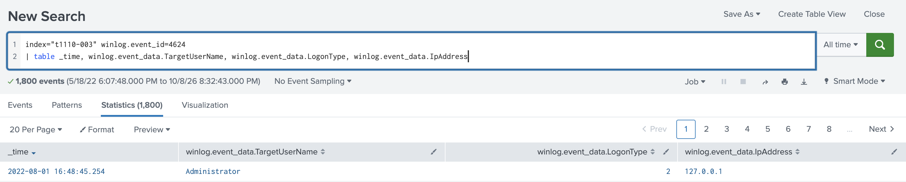
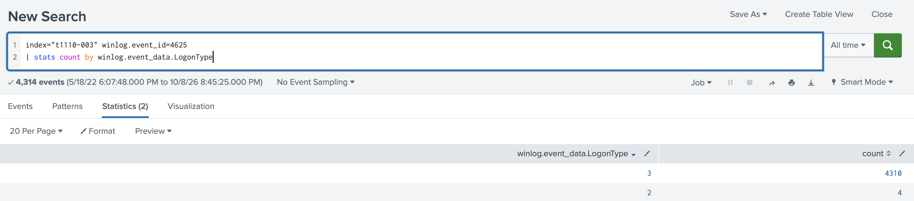
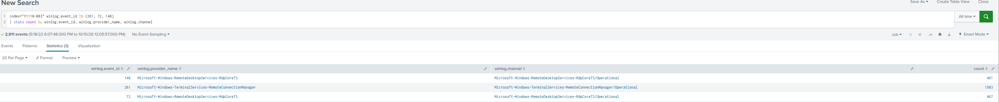
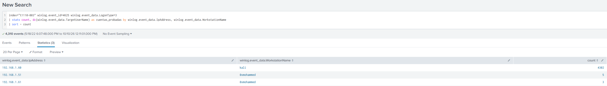
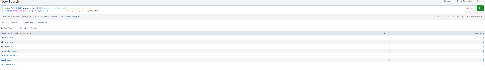
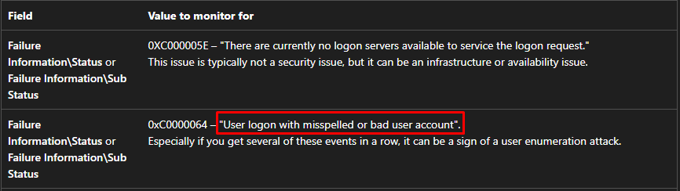
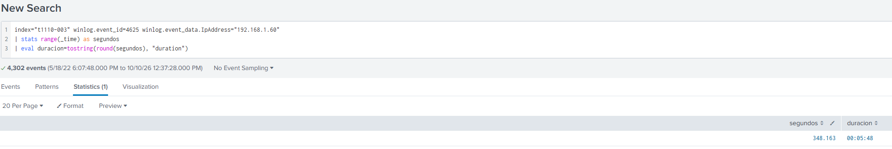
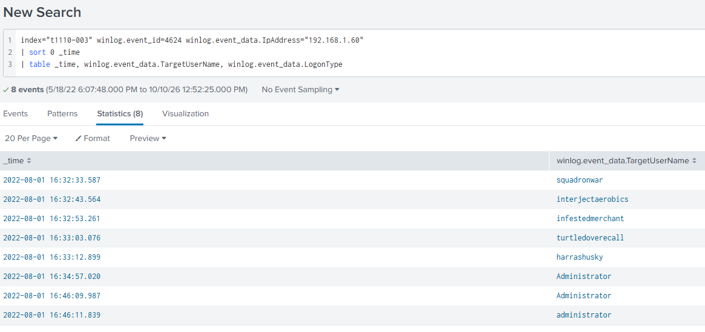

# T1110-003 Lab

## 1. Contexto

**Escenario en una frase:** un atacante lanza un password spraying por RDP contra un equipo Windows y, tras conseguir varias cuentas, entra por escritorio remoto como Administrator.


## 2. Preguntas del lab

### Resumen de preguntas y respuestas

| N.º | Pregunta | Respuesta | Técnica ATT&CK |
| --- | --- | --- | --- |
| P1 | ¿Quién fue el último usuario conectado? | Administrator | Ninguna |
| P2 | ¿Cuál es el tipo de inicio de sesión de los inicios de sesión fallidos? | 3 | Ninguna |
| P3 | ¿Cuál es el protocolo que el atacante intentó aplicar mediante fuerza bruta? | RDP | T1110 |
| P4 | ¿Cuántos usuarios logró el atacante obtener sus cuentas? | 6 | T1110.003, T1078 |
| P5 | Según Microsoft, ¿cuál es la descripción del código de "Subestado" para el ID de evento 4625? | User logon with misspelled or bad user account | T1110.003 |
| P6 | ¿Cuánto tiempo duró la fuerza bruta? MM:SS | 05:48 | T1110.003 |
| P7 | ¿Cuántos minutos pasaron antes de que el atacante volviera a iniciar sesión en la máquina? | 11 | T1078, T1021.001 |
| P8 | ¿Cómo se llama la política utilizada para bloquear la cuenta después de una cierta cantidad de intentos fallidos de inicio de sesión? | Account Lockout | Ninguna |

### Análisis pregunta a pregunta

#### P1

> **Pregunta:** ¿Quién fue el último usuario conectado?

> **Respuesta:** administrator

**Análisis: cómo he llegado**

- **Qué busco:** el último inicio de sesión correcto (evento 4624).
- **Consulta o comando:**

```spl
index="t1110-003" winlog.event_id=4624
| table _time, winlog.event_data.TargetUserName, winlog.event_data.LogonType, winlog.event_data.IpAddress
```

- **Resultado:** 
- **Por qué esa es la respuesta:** Splunk muestra primero el evento más reciente, así que el último usuario conectado es el de la primera fila. Se mira `TargetUserName` (la cuenta que entra) y no `SubjectUserName` (la cuenta que tramita el logon).
- **Técnica ATT&CK:** Ninguna

#### P2

> **Pregunta:** ¿Cuál es el tipo de inicio de sesión de los inicios de sesión fallidos?

> **Respuesta:** 3

**Análisis: cómo he llegado**

- **Qué busco:** por qué vía llegaron los inicios de sesión fallidos (evento 4625).
- **Consulta o comando:**

```spl
index="t1110-003" winlog.event_id=4625
| stats count by winlog.event_data.LogonType
```

- **Resultado:** 
- **Por qué esa es la respuesta:** el LogonType con más accesos fallidos es el 3 (Network), con 4.310 eventos. Los 4 de tipo 2 son ruido. Tipo 3 significa que los intentos vienen de otro equipo por la red.
- **Técnica ATT&CK:** Ninguna

#### P3

> **Pregunta:** ¿Cuál es el protocolo que el atacante intentó aplicar mediante fuerza bruta?

> **Respuesta:** RDP

**Análisis: cómo he llegado**

- **Qué busco:** el servicio de red contra el que el atacante lanzó los intentos de contraseña.
- **Consulta o comando:**

```spl
index="t1110-003" winlog.event_id IN (261, 72, 148)
| stats count by winlog.event_id, winlog.provider_name, winlog.channel
```

- **Resultado:** 
- **Por qué esa es la respuesta:** el evento 261 se registra con cada conexión RDP entrante, y hay casi 2.000 junto a los fallos de logon. Los fallos salen como tipo 3 y no tipo 10 porque RDP con NLA valida la contraseña por red antes de abrir el escritorio.
- **Técnica ATT&CK:** T1110 Brute Force

#### P4

> **Pregunta:** ¿Cuántos usuarios logró el atacante obtener sus cuentas?

> **Respuesta:** 6

**Análisis: cómo he llegado**

Lo primero es localizar quién es el atacante. Me he fijado en el origen con más errores de login:

```spl
index="t1110-003" winlog.event_id=4625 winlog.event_data.LogonType=3
| stats count, dc(winlog.event_data.TargetUserName) as cuentas_probadas by winlog.event_data.IpAddress, winlog.event_data.WorkstationName
| sort - count
```

Es el equipo `kali`, con IP `192.168.1.60`: 4.302 fallos contra 21 cuentas.


- **Qué busco:** logins correctos (4624) desde la IP del atacante.
- **Consulta o comando:**

```spl
index="t1110-003" winlog.event_id=4624 winlog.event_data.IpAddress="192.168.1.60"
| stats count, values(winlog.event_data.LogonType) as tipos by winlog.event_data.TargetUserName
```

- **Resultado:** 
- **Por qué esa es la respuesta:** cada fila es una cuenta en la que el atacante ha hecho login correctamente. `Administrator` y `administrator` son la misma cuenta (Splunk distingue mayúsculas al agrupar), así que son 6.
- **Técnica ATT&CK:** T1110.003 Brute Force: Password Spraying, T1078 Valid Accounts

#### P5

> **Pregunta:** Según Microsoft, ¿cuál es la descripción del código de "Subestado" para el ID de evento 4625?

> **Respuesta:** User logon with misspelled or bad user account

**Análisis: cómo he llegado**

- **Qué busco:** el motivo concreto por el que fallaron los logons, que Windows guarda como código en el campo SubStatus.
- **Consulta o comando:** sin consulta. Documentación de Microsoft del evento 4625: https://learn.microsoft.com/en-us/previous-versions/windows/it-pro/windows-10/security/threat-protection/auditing/event-4625
- **Resultado:** 
- **Por qué esa es la respuesta:** la documentación de Microsoft del evento 4625 describe `0xC0000064` como "User logon with misspelled or bad user account", es decir, la cuenta no existe.
- **Técnica ATT&CK:** T1110.003 Brute Force: Password Spraying

#### P6

> **Pregunta:** ¿Cuánto tiempo duró la fuerza bruta? MM:SS

> **Respuesta:** 05:48

**Análisis: cómo he llegado**

- **Qué busco:** el tiempo entre el primer y el último logon fallido del atacante.
- **Consulta o comando:**

```spl
index="t1110-003" winlog.event_id=4625 winlog.event_data.IpAddress="192.168.1.60"
| stats range(_time) as segundos
| eval duracion=tostring(round(segundos), "duration")
```

- **Resultado:** 
- **Por qué esa es la respuesta:** 16:34:57 menos 16:29:09 son 5 minutos y 48 segundos. Se filtra por la IP del atacante para que los fallos sueltos de otros orígenes no alarguen la ventana.
- **Técnica ATT&CK:** T1110.003 Brute Force: Password Spraying

#### P7

> **Pregunta:** ¿Cuántos minutos pasaron antes de que el atacante volviera a iniciar sesión en la máquina?

> **Respuesta:** 11

**Análisis: cómo he llegado**

- **Qué busco:** cuánto tardó el atacante, una vez terminado el ataque de contraseñas, en entrar a la máquina con una de las cuentas conseguidas.
- **Consulta o comando:**

```spl
index="t1110-003" winlog.event_id=4624 winlog.event_data.IpAddress="192.168.1.60"
| sort 0 _time
| table _time, winlog.event_data.TargetUserName, winlog.event_data.LogonType
```

- **Resultado:** 
- **Por qué esa es la respuesta:** el último evento del ataque es a las 16:34:57 y el siguiente logon correcto desde la IP del atacante (`192.168.1.60`) es a las 16:46:09, como `Administrator`. Entre ambos pasan 11 minutos.
- **Técnica ATT&CK:** T1078 Valid Accounts, T1021.001 Remote Services: Remote Desktop Protocol

#### P8

> **Pregunta:** ¿Cómo se llama la política utilizada para bloquear la cuenta después de una cierta cantidad de intentos fallidos de inicio de sesión?

> **Respuesta:** Account Lockout

**Análisis: cómo he llegado**

- **Qué busco:** el nombre de la política de Windows que bloquea una cuenta cuando acumula demasiados logons fallidos.
- **Consulta o comando:** sin consulta para la respuesta (documentación de Microsoft). Comprobación en los logs de si hubo bloqueos:

```spl
index="t1110-003" winlog.event_id=4740
| stats count
```

- **Resultado:** 8 eventos 4740 (cuenta bloqueada).
- **Por qué esa es la respuesta:** Account Lockout Policy es la directiva que bloquea la cuenta al superar el umbral de fallos (*Account lockout threshold*). Los 8 eventos 4740 demuestran que estaba activa y saltó durante el ataque.
- **Técnica ATT&CK:** Ninguna

## 3. Cierre

### Cadena del ataque

Todas las horas son del 2022-08-01.

1. **16:29:09** El equipo `kali` (`192.168.1.60`) empieza a probar contraseñas por RDP. Se ven como logons fallidos (4625) de tipo 3 con NTLM.
2. **16:32:33 a 16:33:12** Acierta la contraseña de cinco cuentas: `squadronwar`, `interjectaerobics`, `infestedmerchant`, `turtledoverecall` y `harrashusky`.
3. **16:34:57** Acierta la de `Administrator` y el ataque se detiene. Total: 4.302 fallos contra 21 cuentas en 05:48, con 6 cuentas comprometidas y 8 bloqueos de cuenta (4740).
4. **16:46:09** Once minutos después vuelve y entra por RDP como `Administrator`: primero la validación por red (tipo 3) y dos segundos después la sesión de escritorio remoto (tipo 10).
5. **16:48:45** Logon local de `Administrator` (tipo 2, desde 127.0.0.1) y cierre de sesión. Es el último evento del índice. Ocurre con el atacante ya dentro, pero no está confirmado que sea él.

### TTPs

| Táctica | Técnica | Evidencia que la demuestra |
| --- | --- | --- |
| Credential Access | T1110.003 Brute Force: Password Spraying | 4.302 eventos 4625 desde `192.168.1.60` contra 21 cuentas distintas en 05:48 |
| Initial Access | T1078 Valid Accounts | Eventos 4624 desde la IP del atacante en 6 cuentas |
| Lateral Movement | T1021.001 Remote Services: Remote Desktop Protocol | Evento 4624 con LogonType 10 como `Administrator` a las 16:46:11 desde `192.168.1.60`, y eventos 261 de conexiones RDP entrantes |

### IOCs

| Tipo     | Valor                                                                           | Contexto                                                                      |
| -------- | ------------------------------------------------------------------------------- | ----------------------------------------------------------------------------- |
| IP       | 192.168.1.60                                                                    | Origen del password spraying y de la sesión RDP posterior                     |
| Hostname | kali                                                                            | Nombre del equipo atacante (WorkstationName en los 4625)                      |
| Cuenta   | Administrator                                                                   | Comprometida y usada para entrar por RDP                                      |
| Cuentas  | squadronwar, interjectaerobics, infestedmerchant, turtledoverecall, harrashusky | Comprometidas durante el ataque                                               |
| IP       | 192.168.1.51, 192.168.1.61                                                      | Equipo `0xmohammed`, con 5 y 3 fallos de logon. Sospecha menor, sin confirmar |

### Una idea de detección

- **Qué detectaría:** un mismo origen que falla el login contra muchas cuentas distintas en poco tiempo.
- **Fuente de datos:** Windows Security log, evento 4625.
- **Lógica:** agrupar los 4625 de LogonType 3 por `IpAddress` en ventanas de 5 minutos y alertar si una misma IP falla contra 10 o más cuentas distintas (`TargetUserName`). Sube la prioridad si después hay un 4624 desde esa misma IP.
- **Falso positivo probable:** un escáner de vulnerabilidades, un pentest autorizado o un servicio mal configurado que reintenta con credenciales caducadas.
